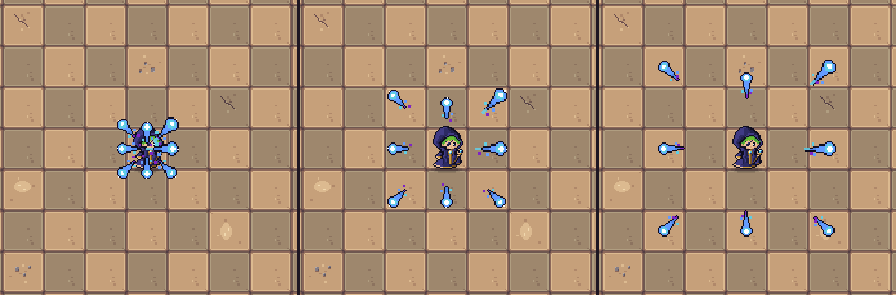
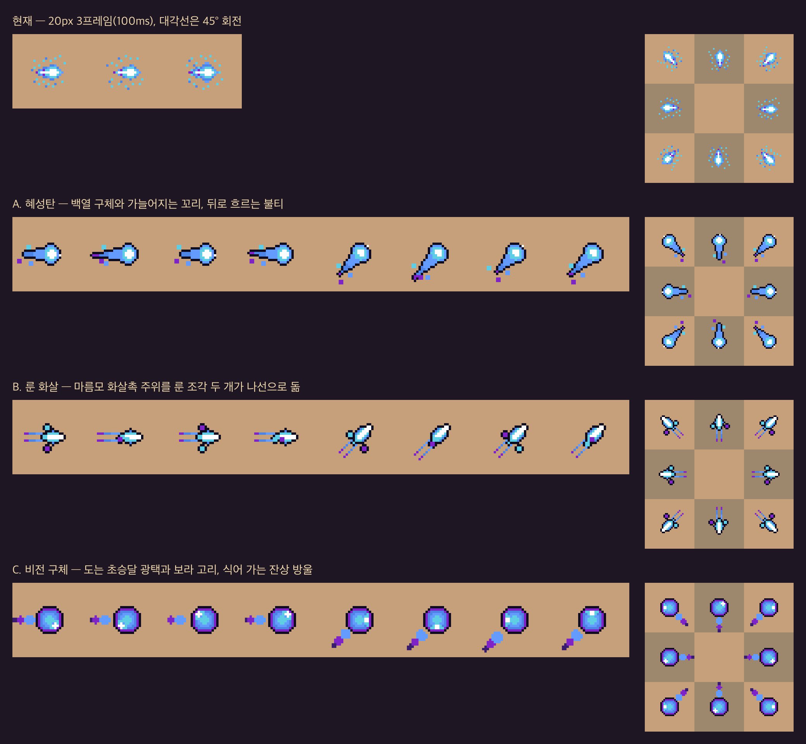

# 플레이어 마법 투사체 시안 v1

2026-10-17 요청: 플레이어 기본 마법 투사체를 고품질로 다시 그리기 위한 초안 3종.

**A. 혜성탄을 다듬어 플레이어 투사체에 적용했다.** B·C는 비교용 시안으로 남긴다. 이전 투사체는 `Assets/Projectiles/Attack/attack.aseprite`(20×20, 3프레임 100ms) 한 장을 진행 방향으로 회전해 썼다. 적 투사체는 지금도 이 그림을 분홍으로 물들여 쓴다.

## 게임 적용 (A 혜성탄)

| 항목 | 위치 |
| --- | --- |
| 시트 | `Assets/Resources/Projectiles/player_comet.png` (256×32, 8프레임: 0–3 오른쪽, 4–7 오른쪽 위 / 32 PPU, Point, 무압축) |
| 재생 | `Assets/Codes/PlayerCometVisual.cs`: `ProjectileManager`가 플레이어 투사체를 만들 때 붙인다 |
| 편집 원본 | `A_comet.aseprite` (태그 `right` 1–4, `diag` 5–8) |

- 상하좌우는 오른쪽 그림, 대각선은 오른쪽 위 그림을 쓰고, 90° 단위로만 돌려 픽셀이 깨지지 않는다.
- 50ms마다 프레임을 넘긴다. 스케일 시간을 써서 일시정지 중에는 멈춘다.
- 기존 3프레임 Animator는 플레이어 투사체에서만 끈다. `TurnProjectile`이 Animator 컴포넌트를 요구해서 컴포넌트는 남긴다.
- 강화 투사체는 지금처럼 1.2배이고, 청록 꼬리를 혜성 꼬리 끝(14px 뒤)에 이어 붙인다. 대각선이면 꼬리도 45° 돌린다.



다듬은 점(시안 대비)
- 핵을 둥근 백열로 바꿨다. 오른쪽은 십자, 대각선은 사각형으로 보이던 문제를 고쳤다.
- 꼬리 첫 청록 띠를 없애 이음매를 지웠다.
- 꼬리를 더 길고 가늘게 줄였다.
- 불티가 캔버스 밖으로 잘리지 않게 안쪽으로 옮겼다.



## 현재 투사체의 문제

- 몸통 주위에 1px 점이 흩어져 있어 바닥 위에서 지저분하게 보인다. ArtStyleBible §3은 고립된 1px 점을 피하라고 한다.
- 외곽선이 없어 사암 바닥과 경계가 약하다.
- 대각선은 한 장을 45° 회전해서 픽셀이 깨진다(위 비교의 오른쪽 3×3 보드).

## 규격

- 32×32 캔버스, 기준점은 중앙. 32 PPU에서 지금 투사체와 비슷한 크기로 보인다.
- 4프레임 반복, 프레임당 50ms. 비행 시간이 0.06~0.25초라, 100ms 프레임으로는 1~2장밖에 보이지 않는다.
- 방향마다 따로 그렸다.
  - `right`(1–4): 오른쪽. 상하좌우는 90° 회전·좌우 뒤집기로 쓴다(픽셀 깨짐 없음).
  - `diag`(5–8): 오른쪽 위. 대각선 4방향은 뒤집기로 쓴다.
- 색: 현재 투사체 5색(`#FFFFFF` `#5FCDE4` `#639BFF` `#4E84E5` `#7E23C6`)에 외곽선 `#0E0C1E`, 식는 보라 `#3A1C6E`를 더했다. 시안마다 6~7색.
- 알파는 0/255만 쓴다. 본체에만 1px 외곽선을 두르고, 꼬리·불티는 외곽선 없이 2px 덩어리로 둔다.

## 시안

| 시안 | 인상 | 장점 | 걱정 |
| --- | --- | --- | --- |
| A. 혜성탄 | 백열 구체와 가늘어지는 꼬리, 뒤로 흐르는 2px 불티 | 지금 투사체의 느낌(밝은 핵·청록)을 가장 잘 잇는다. 방향이 꼬리로 바로 읽힌다 | 무난해서 개성은 약하다 |
| B. 룬 화살 | 마름모 화살촉 주위를 룬 조각 두 개가 나선으로 돈다 | 날카롭고 빠른 느낌. 직선 공격·관통 특성과 잘 맞는다 | 조각이 작아 빠른 비행 중에는 잘 안 보일 수 있다 |
| C. 비전 구체 | 초승달 광택이 도는 큰 구체와 식어 가는 잔상 방울 | 가장 "마법 구슬"답고 무게감이 있다 | 크고 둥글어 방향감이 약하다 |

## 파일

| 파일 | 내용 |
| --- | --- |
| `A_comet.aseprite` 외 2개 | 편집 원본(태그 `right`·`diag`) |
| `A_comet.png` / `.json` 외 2쌍 | 256×32 가로 시트와 태그 JSON |
| `preview/overview.png` | 현재 투사체와 시안의 6배 프레임, 8방향 보드 비교 |
| `preview/*-8dir.gif` | 8방향 보드 위 실제 프레임 속도 반복 재생 |
| `preview/*-6x.png` | 시안별 프레임 6배 확대 |
| `preview/A_comet_ingame_8dir.png` | 게임 화면에서 8방향으로 쏜 혜성탄(0.02·0.045·0.07초) |
| `frames/`, `reference/` | 프레임별 PNG(생성 결과), 비교용 현재 투사체 프레임 |

## 다시 만들기

```bash
python3 make_frames.py      # frames/
python3 make_previews.py    # preview/
aseprite -b --script-param root="$PWD" --script build_aseprite.lua   # *.aseprite
```
