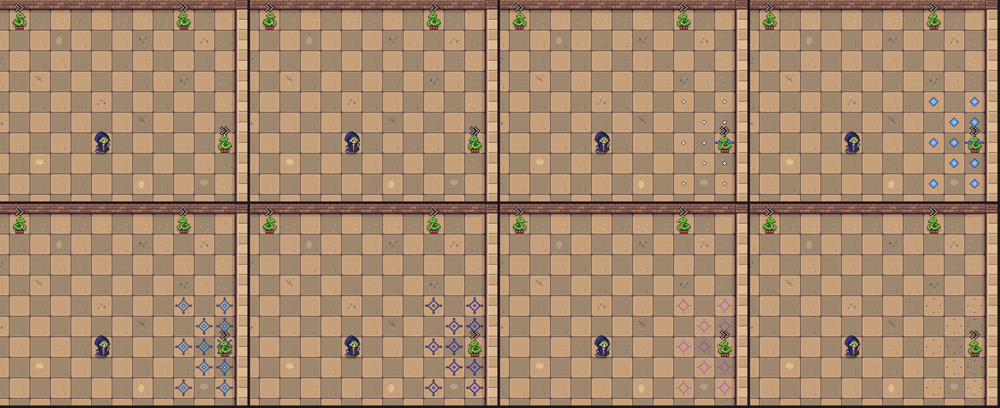
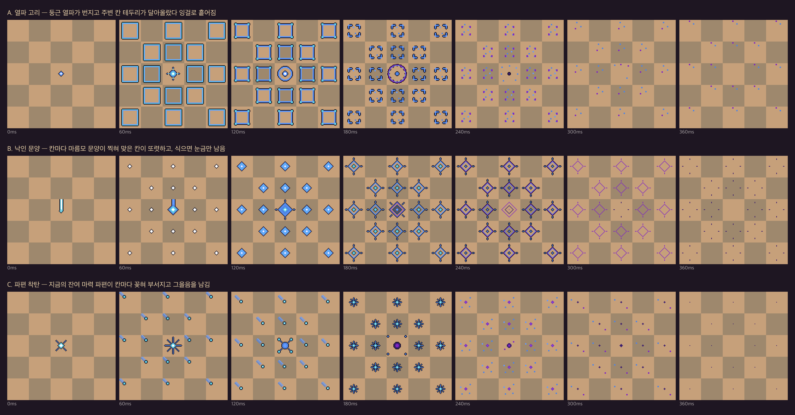
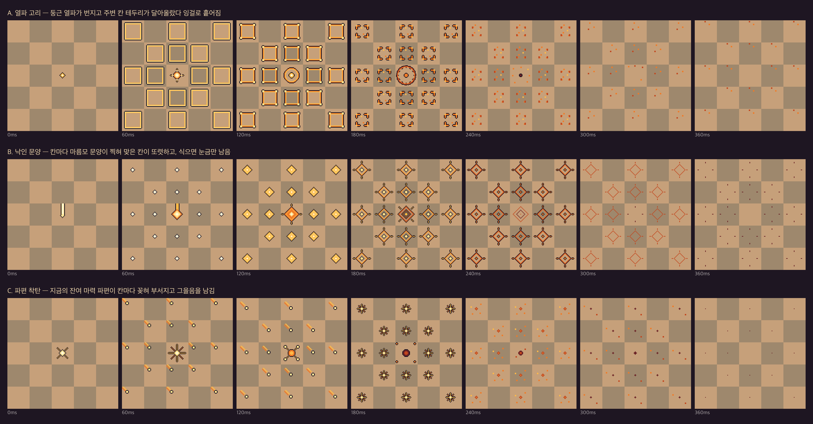

# 범위 공격(강화 폭발) 이펙트 시안 v1

2026-10-16 요청: 강화 폭발(`damage_boost`) 범위 공격 전용 이펙트 초안 3종.

**B. 낙인 문양(magic 색)을 다듬어 게임에 적용했다.** A·C와 warm 버전은 비교용 시안으로 남긴다.

## 게임 적용 (B magic)

| 항목 | 위치 |
| --- | --- |
| 시트 | `Assets/Resources/Effects/damage_boost_sigil_center.png`, `damage_boost_sigil_splash.png` (각 6프레임 192×32, 32 PPU, Point, 무압축) |
| 재생 | `Assets/Codes/DamageBoostSigilEffect.cs` — `RunProgressionSystem.NotifyAttackHit`의 강화 폭발 시점에 호출 |
| 편집 원본 | `B_brand_sigil_magic.aseprite` (태그 `center` 1–6 = center 시트, `splash` 7–12 = splash 시트) |

- 직격 칸에 `center`, 현재 폭발 범위(8·12·16칸)의 바닥 칸에 `splash`를 찍는다. 벽 칸은 건너뛴다.
- 주변 칸은 잔여 마력 파편 도착 시간(80ms) 뒤에 시작한다.
- 바닥 층(정렬 -5)에 그려 캐릭터·피격 반짝임·체력 칸을 가리지 않는다. 그래서 직격 칸 문양은 맞은 적이 서 있으면 가장자리만 보이고, 적이 쓰러지면 전부 보인다.
- 스케일 시간을 쓰므로 일시정지하면 파편과 함께 멈춘다.
- 강화 투사체와 잔여 파편도 마법 색으로 맞췄다. 강화 표시는 1.2배 크기와 청록 꼬리로 남긴다.



다듬은 점(시안 대비): `center` 1프레임 빛기둥 끝에 착탄점을 더했다. 두 태그의 마지막 2프레임은 외곽선 없이 보라로 식게 해 바닥에 검은 점이 남지 않게 했다.

같은 모양을 두 색으로 만들었다.

- **magic(권장):** 기본 마법 투사체(`Assets/Projectiles/Attack/attack.aseprite`)의 5색을 그대로 쓴다. 사암 바닥과 보색이라 범위가 훨씬 잘 보인다.
- **warm:** 강화 투사체에 코드로 입히는 따뜻한 색을 따른 첫 버전.



<details><summary>warm 버전</summary>



</details>

## 규격

- 칸 하나 = 32×32(32 PPU). 나이트 착지 균열(`knight_quake_crack`)과 같은 칸 단위다.
- 시안마다 12프레임, 프레임당 60ms.
  - 태그 `center`(1–6): 직격 칸.
  - 태그 `splash`(7–12): 주변 칸. 폭발 증폭 단계에 따라 8·12·16칸에 같은 애니메이션을 깐다.
- 색은 시안마다 7색이다.
  - magic: 외곽선 `#0E0C1E`, 투사체 색 `#FFFFFF` `#5FCDE4` `#639BFF` `#4E84E5` `#7E23C6`, 식는 보라 `#3A1C6E`.
  - warm: 외곽선 `#0E0C1E`, `#6A2226` `#C2461E` `#F07A26` `#FFBA47` `#FFE08C` `#FFF6D8`.
- 알파 0/255만 쓴다. 주요 형태에만 1px 외곽선을 둘렀고, 작은 불티는 흙 얼룩처럼 보이지 않게 외곽선을 뺐다.
- 미리보기는 실제 게임처럼 주변 칸을 한 프레임(파편 도착 약 80ms) 늦게 시작한다.

## 적용할 때 함께 정할 것

강화 투사체 본체(`#FFE08C` 틴트)와 잔여 마력 파편(`CombatFeedbackFragments`)은 지금 코드에서 따뜻한 색을 입힌다. magic 이펙트를 쓰면 이 둘도 마법 색으로 바꿔야 한 공격 안에서 색이 이어진다. 강화 표시는 색 대신 굵기·꼬리로 남길 수 있다.

## 시안

| 시안 | 인상 | 장점 | 걱정 |
| --- | --- | --- | --- |
| A. 열파 고리 | 둥근 열파가 번지고 주변 칸 테두리가 달아올랐다 잉걸로 흩어진다 | 범위 전체가 한 번에 "터졌다"로 읽힌다 | 칸 테두리가 많아 16칸일 때 화면이 바쁘다 |
| B. 낙인 문양 | 칸마다 마름모 문양이 찍히고, 식으면 눈금만 잠깐 남는다 | 어느 칸이 맞았는지 가장 또렷하다. 조준 미리보기와 같은 언어로 쓰기 좋다 | 폭발보다 마법진 느낌이 강하다 |
| C. 파편 착탄 | 지금의 파편이 칸마다 꽂혀 부서지고 작은 자국을 남긴다 | 현재 연출(파편 비행)과 자연스럽게 이어진다 | 칸 경계가 드러나지 않아 범위 모양은 덜 읽힌다 |

## 파일

| 파일 | 내용 |
| --- | --- |
| `*_magic.aseprite`, `*.aseprite` | 편집 원본(태그 포함). `_magic`이 마법 색 |
| `*_magic.png` / `.json`, `*.png` / `.json` | 384×32 가로 시트와 태그 JSON |
| `preview_magic/`, `preview/` | 5×5 바닥(16칸 범위) 0–360ms 비교, 실제 속도 GIF, 칸 하나 6배 확대 |
| `frames_magic/`, `frames/` | 프레임별 PNG(생성 결과) |

## 다시 만들기

```bash
python3 make_frames.py            # frames/, frames_magic/
python3 make_previews.py          # preview/
python3 make_previews.py magic    # preview_magic/
aseprite -b --script-param root="$PWD" --script build_aseprite.lua                              # *.aseprite
aseprite -b --script-param root="$PWD" --script-param palette=magic --script build_aseprite.lua # *_magic.aseprite
```
