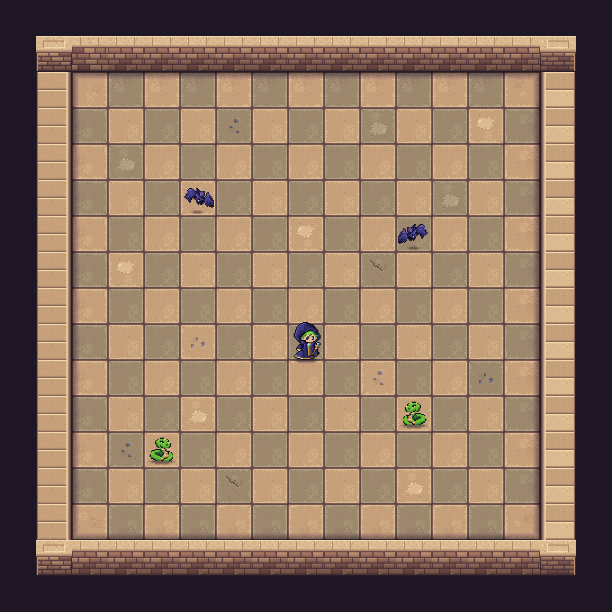
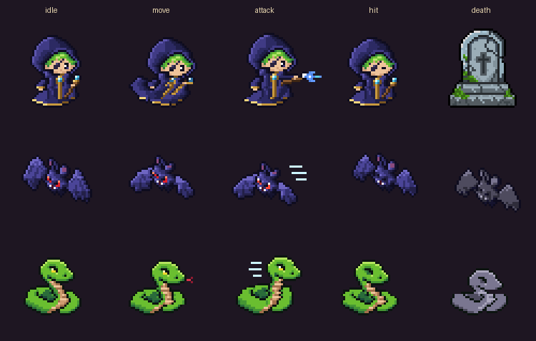

# Grid Caster

> 13×13 보드 전체를 읽고, 몇 수 앞을 계산해 싸우는 **픽셀 아트 턴제 전략 로그라이크**

<p align="center">
  
</p>
<p align="center"><sub>에셋 합성 미리보기(게임 캡처 아님) · <code>Tools/art-preview/make_readme_images.py</code>로 다시 만들 수 있습니다.</sub></p>

| 항목 | 내용 |
| --- | --- |
| 장르 | 타일 기반 턴제 웨이브 생존 · 빌드 로그라이크 |
| 엔진 | Unity `6000.4.0f1` · URP 2D · Input System |
| 주력 플랫폼 | PC (키보드·마우스). 모바일 Safari 웹은 보조 실험 |
| 기준 씬 | `Assets/Scenes/SampleScene.unity` |
| 상태 | 첫 스테이지 프로토타입 (20웨이브, 퀸 보스는 별도 그레이박스 씬) |

---

## 목차

1. [게임 소개](#게임-소개)
2. [조작](#조작)
3. [기능별 구성](#기능별-구성)
4. [저장소 구조](#저장소-구조)
5. [브랜치와 변경 이력](#브랜치와-변경-이력)
6. [문서](#문서)
7. [프로젝트 열기](#프로젝트-열기)

---

## 게임 소개

플레이어가 한 번 행동하면 보드의 모든 적과 남아 있는 투사체가 한 번씩 행동합니다. 빠른 반응보다 **적의 규칙과 배치를 읽고 이동·공격 순서를 계산하는 것**이 핵심입니다.

- 13×13 내부 보드 전체를 고정 시점으로 보며 8방향으로 이동·공격합니다.
- 체스 말처럼 움직이는 적(나이트·비숍·룩)과 기본 몬스터가 웨이브로 등장합니다.
- 시작 특성 하나를 중심으로 강화·유물·이동술을 조합해 런마다 다른 빌드를 만듭니다.
- 첫 스테이지는 20웨이브(10웨이브 중간 혼합전, 20웨이브 최종 혼합전)이며, 클리어 후 전장을 복기하거나 새 빌드로 다시 시작합니다.

확정한 방향은 [게임 정체성](docs/design/game-identity-2026-10-02.md)과 [개발 워크플로우](docs/design/development-workflow-2026-10-02.md)에 있습니다. 스테이지별 독립 런·보스 포함 약 30분 흐름은 **목표**이며, 고유 보스 AI·후속 스테이지·클리어 기록 저장은 아직 구현 전입니다.

## 조작

| 입력 | 동작 |
| --- | --- |
| `A` | 일반 공격 방향 선택 |
| `S` | 기본 이동 / 습득한 이동술 |
| `F` | 준비한 특성 공격 |
| 마우스 올리기 | 공격 경로 미리보기 |
| 좌클릭 / 우클릭 | 실행 / 취소 |
| 보유 강화·유물·이동술 클릭 | 상세 설명 (행동을 소비하지 않음) |

---

## 기능별 구성

각 기능의 핵심 코드와 설계·검증 문서를 함께 정리했습니다. 코드는 `Assets/Codes/`, Editor 설정·검증 도구는 `Assets/Editor/`에 있습니다.

### 1. 턴제 전투와 보드

플레이어 행동 → 적 행동 → 투사체 이동 → 충돌·피해·사망 판정 순서로 진행합니다. 연출은 프레임 단위로 보이지만 판정은 타일 좌표와 명시적 행동 호출로만 결정합니다.

| 구분 | 파일 |
| --- | --- |
| 플레이어 행동 | `Move.cs`, `PlayerActionSelectionMode.cs` |
| 적 행동 | `MonsterMovement.cs`, `ChessMonsterBehaviour.cs`, `MonsterMovementPattern.cs` |
| 웨이브·보드 | `MonsterSpawner.cs`, `WaveTemplate.cs`, `ChessWaveDisplay.cs`, `GridManager.cs`, `StageFlowManager.cs` |
| 투사체 | `ProjectileManager.cs`, `TurnProjectile.cs`, `BishopFireTrail.cs` |

문서: [웨이브 구성](ChessWaves.md) · [체스 플레이테스트](ChessPlaytest.md) · [나이트 반격 기회](docs/design/knight-counter-opportunity-2026-10-04.md) · [넉백 충돌](docs/design/knockback-collision-2026-10-05.md)

### 2. 타격 피드백

명중·처치·넉백 결과를 즉시 읽을 수 있도록 반동, 스파크, 사망 잔상, 잔여 마력 파편, 카메라 충격을 씁니다. 판정과 점유는 원본 오브젝트에 남기고, 연출은 복사한 비전투 스프라이트로 표현합니다.

| 구분 | 파일 |
| --- | --- |
| 반응 연출 | `CombatFeedback.cs`, `CombatFeedbackFragments.cs`, `DamageFlash.cs`, `CameraController.cs` |
| 범위 피해 | `DamageBoostArea.cs` |
| 위협·행동 표시 | `EnemyThreatPreview.cs`, `DirectionalActionIndicator.cs` |

문서: [타격감 가설](docs/design/impact-feel-hypotheses-2026-10-04.md) → [요소별 순위](docs/design/impact-feel-ranking-2026-10-04.md) → [통합](docs/design/impact-feedback-integration-2026-10-04.md) → [잔여 마력 파편](docs/design/impact-presentation-2026-10-05.md)

### 3. 성장과 빌드

네 가지 시작 특성을 비교 기준으로, 강화·유물·이동술을 조합합니다. 보상 카드에는 핵심 효과·확률·레벨을, 상세창에는 정확한 조건을 표시합니다.

| 구분 | 파일 |
| --- | --- |
| 성장 판정·데이터 | `RunProgressionSystem.cs`, `RunProgressionCatalog.cs`, `RunProgressionDescriptions.cs`, `TraitOptionData.cs` |
| 시작 특성 | `PlayerTraitSystem.cs` |
| 보상·HUD | `RunProgressionUiController.cs`, `GameHudController.cs` |

문서: [성장과 유물 규칙](GrowthAndRelics.md) · [네 빌드 분리 실험](docs/design/four-build-identities-2026-10-01.md) · [빌드 편향 추첨](docs/design/build-variation-and-bishop-fire-2026-10-04.md) · [ADR 0001](docs/adr/0001-hybrid-run-progression.md)

### 4. 퀸 보스 (그레이박스)

첫 스테이지 보스 후보인 퀸의 패턴과 체크메이트 밸런스를 단색 그레이박스 씬에서 먼저 검증합니다. 본편 `SampleScene`에는 아직 연결하지 않았습니다.

| 구분 | 파일 |
| --- | --- |
| 보스 로직 | `QueenBossBehaviour.cs`, `QueenSafeZonePlanner.cs` |
| 플레이테스트 | `QueenBossPlaytest.cs`, `QueenBossPlaytestUi.cs`, `Assets/Scenes/QueenBossPlaytest.unity` |
| 콘셉트 시안 | `Art/Concepts/` (퀸·폰 근위대 시안 v1–v10) |

문서: [패턴 제안](docs/design/queen-boss-pattern-proposal-2026-10-11.md) · [그레이박스 비교](docs/design/queen-graybox-test-2026-10-12.md) · [Unity 플레이테스트](docs/design/queen-boss-unity-playtest-2026-10-12.md) · [체크메이트 밸런스](docs/design/queen-checkmate-balance-proposal-2026-10-12.md)

### 5. 아트와 캐릭터 모션

32 PPU 픽셀 아트, Point 필터. 캐릭터는 대기·이동·공격·피격·사망 모션을 가지며, 공격 판정은 모션이 내지르는 프레임에 맞춰 나갑니다. 캐릭터마다 발밑 픽셀 그림자가 있습니다.

<p align="center">
  
</p>

| 구분 | 파일 |
| --- | --- |
| 모션 연결 | `ActorMotion.cs` (공격·피격·사망·이동 트리거, 공격 시전 시간) |
| 그림자 | `CharacterShadow.cs` |
| 시트·클립 생성 | `Assets/Editor/LivelyMotionSetupTool.cs` (메뉴 `Tools/Art/Apply Lively Motions`) |
| 게임 에셋 | `Assets/Player/`, `Assets/Monsters/`, `Assets/TIles/` |
| 제작 원본 | `Art/Sources/` (Aseprite), `Art/Icons/`, `Art/Backups/` |

문서: [이미지 콘셉트 기준](IMAGE_CONCEPT_BRIEF.md) · [아트 폴더 안내](Art/README.md)

### 6. 오디오

선정한 6개 전투 효과음(마법 발사·약/강 명중·플레이어 피격·나이트 착지·화염)을 재생하고 일시정지 메뉴에서 음량을 조절합니다.

| 구분 | 파일 |
| --- | --- |
| 재생·설정 | `GameAudio.cs`, `PauseAudioSettings.cs` |
| 게임 리소스 | `Assets/Resources/CombatSFX/` |
| 제작·선정 자료 | `Art/Audio/` |

문서: [효과음 조사](docs/design/combat-sfx-inventory-2026-10-03.md) → [제작 방식](docs/design/combat-sfx-production-method-2026-10-03.md) → [청취 선택](docs/design/combat-sfx-selection-2026-10-03.md) → [적용](docs/design/combat-audio-integration-2026-10-04.md)

### 7. 플랫폼 (PC · 모바일 웹)

PC 화면이 기준입니다. 보드와 HUD는 `PcBoardLayout`의 공통 배율·간격을 따르고, 데스크톱 Web과 모바일 브라우저를 구분해 입력을 붙입니다.

| 구분 | 파일 |
| --- | --- |
| 레이아웃·입력 | `PcBoardLayout.cs`, `MobilePlaytestController.cs`, `Assets/Plugins/WebGL/` |
| 빌드·스모크 | `Assets/Editor/MobileWebBuild.cs`, `Tools/mobile-playtest/` |

문서: [ADR 0002 PC 우선](docs/adr/0002-pc-first-board-experience.md) · [PC 화면과 빌드 확인 창](docs/design/pc-build-inventory-2026-10-14.md) · [모바일 Safari 플레이테스트](docs/design/mobile-safari-playtest.md)

---

## 저장소 구조

```text
Grid-Caster/
├─ Assets/
│  ├─ Codes/            런타임 C# (전투·성장·보스·연출·오디오·플랫폼)
│  ├─ Editor/           설정 도구(*SetupTool)와 자동 검증(*Validation)
│  ├─ Scenes/           SampleScene(본편) · ChessPlaytest · QueenBossPlaytest
│  ├─ Player/ Monsters/ TIles/  게임이 로드하는 스프라이트·클립·컨트롤러
│  └─ Resources/        런타임 로드 리소스(효과음·아이콘)
├─ Art/
│  ├─ Sources/          Aseprite 제작 원본
│  ├─ Concepts/         보스·근위대 콘셉트 시안
│  ├─ Icons/ Audio/     아이콘·효과음 제작 자료
│  └─ Backups/          교체 전 원본
├─ docs/
│  ├─ design/           기획·제안 (날짜별)
│  ├─ adr/              확정한 설계 결정
│  ├─ verification/     실행 결과와 검증 한계
│  ├─ experiments/      재현 가능한 오프라인 실험
│  ├─ reviews/          변경 묶음 리뷰 안내
│  └─ images/           README 이미지
├─ Tools/               브라우저 스모크·그레이박스·README 이미지 스크립트
├─ AGENTS.md            개발 원칙과 구현 규칙
├─ CONTEXT.md           게임 도메인 용어
└─ CONTRIBUTING.md      브랜치·커밋·게시 규칙
```

## 브랜치와 변경 이력

변경은 **앞 단계에 의존하는 누적 브랜치**로 게시합니다. 최신 전체 상태는 마지막 브랜치에서 받고, 각 파트만 보려면 바로 앞 브랜치와 비교합니다. `main`에는 아직 병합하지 않았습니다.

| 순서 | 브랜치 | 담당 변경 | 리뷰 안내 |
| --- | --- | --- | --- |
| 1 | `feature/progression-movement` | 성장 판정·보상 레벨·이동술 S 입력 | [10-01](docs/reviews/2026-10-01-change-series.md) |
| 2 | `feature/combat-board` | 체크무늬 보드·룩 사선·웨이브 조합 | 〃 |
| 3 | `feature/ui-usability` | HUD 상세·시작 조작 안내 | 〃 |
| 4 | `feature/art-resources` | 아르마딜로·아이콘 원본 | 〃 |
| 5 | `docs/design-review` | 현행 규칙·밸런스 검토·게시 규칙 | 〃 |
| 6 | `feature/build-identity-pruning` | 타격 피드백·오디오·퀸 보스·PC/모바일·캐릭터 모션·맵 아트 | [10-14](docs/reviews/2026-10-14-change-series.md) |

커밋 형식은 `type(scope): 한국어 요약` + 배경·변경·검증·주의사항 본문입니다. 자세한 규칙은 [CONTRIBUTING.md](CONTRIBUTING.md)를 따릅니다.

## 문서

기능별 문서 지도는 **[docs/README.md](docs/README.md)** 에 있습니다. 실험안·제안 문서는 게임에 구현된 기능 목록이 아니며, 검증 자료는 [검증 자료 안내](docs/verification/README.md)의 구분(자동 검사 / 과거 결과 / 사람의 플레이테스트)을 따릅니다.

## 프로젝트 열기

1. Unity Hub에서 **Add project from disk**로 이 폴더를 선택합니다.
2. Unity `6000.4.0f1`로 엽니다.
3. `Assets/Scenes/SampleScene.unity`를 열고 Play 합니다.

`Library`, `Temp`, `Logs`, `UserSettings`, IDE 프로젝트 파일은 Unity가 다시 만들므로 Git에 포함하지 않습니다. `Assets/_Recovery/` 복구 씬도 로컬에만 둡니다.
