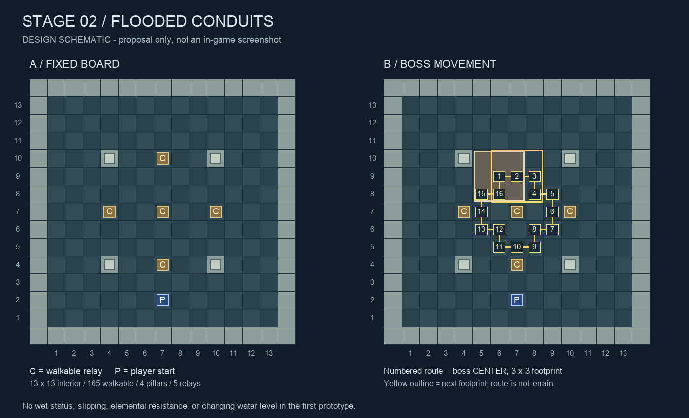

# 2스테이지 제안 — 침수된 뇌전 수로

작성일: 2026-10-15. **검토용 신규 제안이며, 확정 규칙·구현 완료 보고가 아니다.**

현재 저장소에는 2스테이지의 구체적인 맵·시작 특성·몬스터 구성이 확정되어 있지 않다. 이 문서는 기존 정체성을 바탕으로 하나의 방향을 끝까지 연결한 설계 초안이다. 코드·씬·현재 1스테이지·스타일 바이블·도메인 용어는 변경하지 않는다. 아래 수치, 이름, 16웨이브 구성은 플레이테스트 전 가설이다.

기준 문서: [게임 정체성](game-identity-2026-10-02.md), [개발 순서](development-workflow-2026-10-02.md), [도메인 용어](../../CONTEXT.md), [현행 성장](../../GrowthAndRelics.md), [1스테이지 빌드 분리](four-build-identities-2026-10-01.md), [아트 기준](../../ArtStyleBible.md).

## 1. 추천안의 핵심

**침수된 고대 수로에서 적의 연결과 다음 위치를 읽는 스테이지.**

1스테이지에서 익힌 이동·직선 공격·저장한 특성 공격을 유지한다. 달라지는 질문은 “어느 방향으로 쏠까?”에 더해 “어느 적을 먼저 맞혀야 연결될까?”, “다음 행동 뒤 적이 어디에 올까?”다.

| 항목 | 추천 초안 |
| --- | --- |
| 무대 | 물이 얕게 고인 석조 수로와 멈춘 황동 수문기관 |
| 전체 인상 | 짙은 청록 바닥, 밝은 상아색 돌, 황동 기계, 소량의 노란 전기 |
| 보드 | 내부 13×13 유지, 고정 기둥 4개와 전도판 5개 |
| 타일의 실제 규칙 | 일반 바닥 / 걸을 수 있는 전도판 / 못 가는 벽·기둥 |
| 신규 시작 특성 | 연쇄 전격, 서리 각인 두 개 |
| 몬스터 | 추적병·예고 돌격수·왕복 장어·회전 포대·죽을 때 터지는 말미잘 |
| 보스 | 정해진 경로로 움직이는 3×3 수문기관 아르코 |
| 분량 | 우선 16웨이브 가설, 마지막 웨이브 보스 |
| 성장 | 시작 강화 1회 + 진행 중 7회, 유물 기회 3회 |
| 반복 이유 | 같은 맵에서도 연결 경로·예측 지점·이동술·성장 선택이 달라짐 |
| 추가하지 않을 것 | 젖음, 감전 스택, 빙결 게이지, 속성 저항표, 강제 미끄러짐, 날씨 추첨 |

‘물이 있으니 번개가 전부 퍼지고 얼리면 발판이 생긴다’까지 확장하지 않는다. 물은 무대이고, 전도판만 명시적인 연결 규칙을 가진다. 덕분에 보드를 읽을 때 기억해야 할 새로운 상시 규칙은 적다.

### 다른 테마와 비교

| 후보 | 만들 수 있는 판단 | 이번 추천에서 밀리는 이유 |
| --- | --- | --- |
| 침수된 뇌전 수로 | 적 연결, 미래 위치, 폭발 대상 선택 | 가장 적은 지형 규칙으로 두 빌드와 적을 연결하기 좋음 |
| 거울 천문대 | 반사각, 간접 공격, 분신 구분 | 기본 8방향·직선 공격에 반사 예외가 많이 붙을 위험 |
| 포자 정원 | 번지는 위험, 정리 순서, 제한된 안전 공간 | 지속 피해·중첩·시야 효과를 늘리기 쉽고 비숍 불길과 겹침 |
| 얼어붙은 협곡 | 미끄러짐·바람·강제 이동 | 한 칸 이동의 예측성을 흔들며 이동술 필수 구간을 만들기 쉬움 |

다른 후보도 이후 스테이지에 쓸 수 있지만, 이 문서에서는 수로 한 방향만 상세화한다.

## 2. 유지하는 경험과 바꾸는 경험

| 판단 | 1스테이지에서 이어받는 것 | 2스테이지에서 실험할 것 |
| --- | --- | --- |
| 공격 | 8방향 일반 공격, 먼저 맞는 적, 명확한 벽 차단 | 첫 대상 뒤에 연결되는 적의 배치 |
| 이동 | 한 칸 이동과 하나의 이동술, 행동 비용 | 적의 다음 위치를 유도하고 예정 공격에서 빠져나오기 |
| 강한 공격 | 일반 공격으로 충전, 준비 1회 저장, F로 직접 사용 | 연결이 좋은 순간 / 예측이 맞는 순간까지 기다리기 |
| 지형 | 고정 보드와 가려지는 공격선 | 걸을 수 있는 연결점과 작은 기둥 우회 |
| 적 | 규칙을 읽으면 대응 가능 | 고정 왕복·잠근 돌격선·죽을 때의 폭발 이용 |
| 성장 | 하나의 시작 특성 + 전용·공용 강화 + 유물 | 같은 특성 안에서도 연결 수·단일 집중·사거리 등의 선택 |

두 빌드가 모두 ‘주변에 피해를 뿌리는 마법’으로 느껴지면 실패다. 전격은 **현재 적 사이의 연결**, 서리는 **다음 위치와 행동 순서**가 성과를 가르는지 확인해야 한다.

이 스테이지 때문에 1스테이지의 특성 네 개를 폐기하거나 전격·서리를 모든 스테이지의 필수 선택지로 만들지 않는다. 각 스테이지가 제공하는 시작 후보를 따로 둘 수 있다는 기존 방향을 따른다.

## 3. 보드와 타일 형식

### 3.1 좌표와 고정 배치

내부 좌표는 x=1~13, y=1~13이며 위가 +y다. 바깥 한 줄은 경계 벽이다. 이 좌표는 제안서용 로컬 좌표이므로 기존 Unity Tilemap 좌표와 연결할 때 변환한다.

- 플레이어 시작: (7,2).
- 기둥: (4,4), (10,4), (4,10), (10,10).
- 전도판: (4,7), (7,4), (7,7), (10,7), (7,10).
- 보드 구조는 모든 웨이브에서 유지한다. 적·제단·예고만 바뀐다.
- 기둥 네 칸을 제외한 내부 165칸은 모두 이동 가능하다. 전도판 다섯 칸도 이 165칸에 포함된다.



아래는 같은 배치의 텍스트 버전이다. `#`=벽·기둥, `C`=전도판, `P`=시작 위치, `.`=바닥. 위쪽이 y=13이다.

```text
###############
#.............# 13
#.............# 12
#.............# 11
#...#..C..#...# 10
#.............#  9
#.............#  8
#...C..C..C...#  7
#.............#  6
#.............#  5
#...#..C..#...#  4
#.............#  3
#......P......#  2
#.............#  1
###############
 1234567890123
```

넓은 맵으로 난이도를 올리지 않는다. 외곽을 돌아다닐 여유, 중앙에서 방향을 바꿀 여유, 전도판을 경유할 이유를 동시에 확보하는 것이 목적이다. 기둥 옆을 지나갈 때의 대각선·코너 판정은 현행 GridManager 규칙과 일치시킨다. 문서만 보고 새로운 코너 통과 규칙을 추가하지 않는다.

### 3.2 타일별 실제 기능

| 타일 | 이동 | 공격·연결 | 목적 |
| --- | --- | --- | --- |
| 젖은 석재 바닥 | 일반 1칸 | 일반 판정 | 기준이 되는 조용한 바탕 |
| 얕은 물 표현 | 일반 바닥과 동일 | 일반 판정 | 무대 표현. 느려짐·젖음 없음 |
| 전도판 | 일반 1칸, 피해 없음 | 전격의 중간 연결점 | 적이 떨어져 있어도 특정 위치에서 연결 가능 |
| 기둥 | 진입 불가 | 공격선 차단 | 추적 경로와 발사 위치 변화 |
| 외곽 깊은 물·수문 벽 | 진입 불가 | 경계 벽과 동일 | 맵의 끝을 명확하게 표시 |
| 서리 표식 | 이동 가능 | 다음 플레이어 행동 뒤 폭발 | 지형을 바꾸지 않는 일시 공격 예고 |
| 적 공격 예고 | 이동 가능 | 표시된 적 행동 때 피해 | 위험 정보. 바닥 자체의 추가 기능은 아님 |
| 유물 제단 | 기존 규칙 | 기존 규칙 | 안전·위험 위치 중 선택 |

깊은 물은 우선 외곽 장식으로만 둔다. 내부에 구멍·다리·낙사 칸을 섞지 않는다. 물처럼 보이지만 못 가는 칸과 갈 수 있는 칸은 명도·테두리로 확실히 구분한다.

### 3.3 전도판 규칙

1. 플레이어와 적이 걸어서 들어갈 수 있다. 밟았다는 이유로 충전·피해·특성 발동이 생기지 않는다.
2. 전격은 `적 → 인접한 빈 전도판 → 그 전도판에 인접한 다른 적`으로 이어질 수 있다.
3. 인접은 8방향 한 칸이다. 벽·코너 차단 규칙을 통과해야 한다.
4. 적 한 명에서 다음 적 한 명으로 넘어갈 때 전도판은 최대 하나만 경유한다.
5. 전도판끼리 이어지지 않는다. 물 전체가 통전되지 않는다.
6. 플레이어가 차지한 전도판은 중계하지 않는다. 적이 차지하면 전도판 노드를 따로 만들지 않고 그 적 하나로 취급한다.
7. 다칸 보스는 점유 칸 중 가장 가까운 칸으로 인접을 계산하되, 같은 보스에 여러 번 맞지 않는다.
8. 충전량·사용 횟수·재생성 시간이 없다. 추가 HUD도 필요 없다.

첫 비교 테스트에서 전도판이 없어도 전격의 목표 선택이 충분히 재미있다면 판을 줄이거나 제거할 수 있다. ‘새로운 타일이 반드시 있어야 한다’는 전제는 두지 않는다.

## 4. 공통 전투와 시간 규칙

### 4.1 수치 출발점

| 항목 | 첫 그레이박스 가설 |
| --- | --- |
| 시작 최대 체력 | 10 |
| 일반 공격 | 피해 1, 현행 8방향·무제한 직선 사거리 |
| 특성 충전 | 일반 공격 직접 적중 행동 3회 |
| 특성 저장 | 1회, 준비 중 추가 축적 없음 |
| 빈도 강화 | 최대 1회, 필요 적중 3→2 |
| 기본 이동 | 8방향 한 칸 |
| 이동술 | 현행 셋 중 하나만 보유, 사용은 행동 한 번 |
| 적의 체력 증가 | 처음에는 웨이브별 자동 증가 없이 고정 |
| 난이도 증가 | 적의 역할 조합·배치·예고 겹침으로 조절 |

체력 10은 현재 플레이어의 실제 저장값을 주장하는 것이 아니라 2스테이지 비교 실험용 값이다. 첫 스테이지 실측에서 다른 기준이 더 적절하면 같은 값으로 비교한다.

### 4.2 행동 처리 순서

1. 플레이어가 이동·일반 공격·특성 공격·이동술·대기 중 하나를 확정한다.
2. 그 플레이어 행동의 이동·공격 판정과 직접 발생한 사망 효과를 처리한다.
3. **이 행동보다 먼저 설치되어 있었고 이번 행동 뒤 만료되는 서리 표식**을 폭발시킨다.
4. 그 폭발로 이어진 사망 효과까지 모두 처리한다.
5. 플레이어 사망과 전투 종료 가능 여부를 판단한다.
6. 전투가 계속되면 적이 각각 한 번 행동한다.
7. 보드에 남는 적·특수 투사체, 기존 함정·상태 효과 순서를 처리한다.
8. 남은 사망 효과를 정리한 뒤 웨이브 종료를 최종 판정한다.
9. 종료되지 않았다면 다음 입력을 받는다.

서리 때문에 ‘플레이어 행동 완료 후, 적 행동 전’ 지점이 하나 필요하다. 현재 코드가 이미 이 지점을 제공한다고 가정하지 않는다. 향후 구현 시 TurnManager의 기존 흐름에 필요한 최소 처리만 연결한다.

선택·취소·검사·상세창·일시정지는 완료한 플레이어 행동이 아니다. 이때 표식·예고·왕복 적·특성 충전은 진행하지 않는다. 애니메이션 길이, 실제 시간, 프레임 수로 만료를 결정하지 않는다.

### 4.3 피해 출처를 구별하는 기준

| 출처 | 일반 적중 충전 | 직접 적중 유물 | 직접 처치 유물 |
| --- | --- | --- | --- |
| A 일반 공격 | 행동당 1회 | 가능 | 가능 |
| 전격의 최초 직격 | 없음 | 가능 | 가능 |
| 전격의 후속 연쇄 | 없음 | 불가 | 불가 |
| 서리 중심·가지 | 없음 | 불가 | 불가 |
| 말미잘 사망 폭발 | 없음 | 불가 | 불가 |

서리는 지면에 예약한 범위 공격이므로 일반적인 ‘직격’으로 바꾸지 않는다. 나이트 이동술 Lv.3처럼 다음 첫 직격에 사용하는 저장 효과는 서리를 설치할 때 기존 공격 소모 정책에 맞춰 소모하되, 서리 피해에는 얹지 않는 안을 우선 비교한다. 이 불리함을 숨기지 말고 선택 카드에 표시한다. 일반 공격을 먼저 사용해 저장 효과를 활용할 수도 있다. 실제 채택 전에는 두 특성과 기존 이동술의 호환성을 별도 검토한다.

## 5. 시작 특성 A — 연쇄 전격

### 5.1 기본 공격 규칙

**첫 대상의 위치가 전체 공격 경로를 결정한다.**

- F로 8방향 하나를 고르고 확정한다. 최초 투사체는 일반 공격과 같이 첫 유효 적 또는 경계 벽까지 간다.
- 최초 적 피해 2. 그 뒤 서로 다른 적 최대 두 명에게 순서대로 피해 1씩 전달한다. 기본 최대 3명이다.
- 적 사이를 직접 잇거나, 전도판 하나를 경유한다. 적 사이 직접 연결은 8방향 한 칸이다.
- 한 적은 한 번만 타격한다. 죽은 적에게 되돌아오거나 보스 점유 칸을 여러 명으로 세지 않는다.
- 최초 적이 죽어도 그 적의 원래 타일에서 계획된 연결은 이어진다.
- 최초 적을 맞히지 못하면 후속 연쇄가 없다. 전도판만 맞혀 공격을 시작하지 않는다.
- 사용을 확정하면 준비를 소모한다. 일반 공격과 별개의 추가 적 턴은 만들지 않는다.

### 5.2 경로 선택과 예고

공격 확정 시점의 보드로 전체 경로를 만든다. 기본 최대 3명, 강화 후 기본 최대 5명이라 작은 범위의 후보 경로를 비교할 수 있다. 구현 비용을 측정하기 전부터 일반 그래프 엔진을 만들지는 않는다.

동일 최초 대상에서 후보가 여럿이면 다음 기준으로 한 경로를 고른다.

1. 허용된 최대 대상 수 안에서 가장 많은 서로 다른 적을 잇는다.
2. 같은 수라면 전도판 경유가 더 적은 경로를 우선한다.
3. 다시 같으면 각 대상의 `(y, x, 안정적인 생성 ID)` 순으로 경로를 사전식 비교한다.

조준 중 최초 대상과 2·3번 대상까지 번호와 선으로 보여준다. 플레이어가 후속 적을 매번 클릭하지 않으며, 랜덤 분기나 조용한 재조준을 하지 않는다.

말미잘 폭발 등으로 뒤쪽 예정 대상이 먼저 사망하면 그 대상의 타격은 건너뛴다. 이미 확정한 경로의 타일을 따라 다음 예정 대상으로 이어가되, 새 적을 끼워 넣지 않는다. 이동은 아직 적 턴 전이므로 발생하지 않는다. 따라서 예고에서 보지 못한 적에게 갑자기 전격이 뛰는 일은 없다.

UI에는 ‘연쇄 타격 예정’과 ‘폭발까지 포함한 결과’를 구별한다. 폭발로 먼저 죽을 대상에는 중복 피해 숫자를 더하지 않는다.

### 5.3 같은 특성 안의 빌드 방향

| 방향 | 고르는 성장 | 플레이 중 달라지는 질문 | 약점 |
| --- | --- | --- | --- |
| 넓은 회로 | 연쇄 대상 증가·후속 피해 | 어느 적을 첫 대상으로 삼으면 더 길게 이어지나? | 적이 흩어지면 대상 수를 활용하기 어려움 |
| 접점 사냥 | 전도판 보너스·기동·제단 경로 | 어느 방향에서 접근해야 전도판 너머로 닿나? | 전도판만 쫓으면 돌격선에 갇힐 수 있음 |
| 일점 집중 | 최초 피해·고립 대상 보완·생존 | 연결이 나빠도 지금 한 명을 지워야 하나? | 전장의 총 정리량이 상대적으로 낮음 |

전도판을 필수 딜 조건으로 만들지 않는다. 보스도 전도판·말미잘 없이 일반 공격과 최초 직격으로 처치할 수 있어야 한다.

## 6. 시작 특성 B — 서리 각인

### 6.1 기본 공격 규칙

**지금 있는 적에게 즉시 터뜨리는 대신, 다음 위치를 예약한다.**

- F로 플레이어의 8방향 직선 중 1~3칸 떨어진 이동 가능한 타일을 고른다. 빈 칸이나 적이 있는 칸 모두 가능하다.
- 자기 칸은 고르지 못한다. 벽·기둥 뒤로 설치하지 못한다. 선택 가능한 지면을 직접 표시한다.
- 적은 시야 차단물이 아니므로 앞의 적 너머 지면도 선택할 수 있다. 벽은 차단한다.
- 중심과 상하좌우 인접 4칸, 총 최대 5칸에 표식을 둔다.
- 설치 순간에는 피해가 없다. 설치 직후 적이 한 번 행동한다.
- **그다음 플레이어 행동이 끝난 직후, 다음 적 행동 전에** 한 번 폭발한다.
- 중심 피해 3, 가지 피해 1. 다칸 적은 가장 높은 해당 피해로 한 번만 맞는다.
- 플레이어 자신은 서리 피해를 받지 않는다. 폭발 범위에 있던 말미잘이 죽으면 그 사망 폭발은 플레이어에게도 피해를 줄 수 있다.
- 벽 안에는 피해 칸을 만들지 않는다. 길어진 가지는 벽을 만나면 그 방향을 끝낸다.
- 기본 표식은 동시에 하나다. 다른 표식을 설치하는 것보다 먼저 기존 표식이 처리되어야 한다.
- 빙결·둔화·이동 불가·불길 생성은 없다.

### 6.2 타이밍 예시

| 순서 | 플레이어 | 적 | 서리 |
| --- | --- | --- | --- |
| P0 | (7,7)에 설치 | 아직 행동 전 | 설치만 됨, 피해 없음 |
| E0 | 입력 불가 | 추적병이 (7,8)→(7,7)로 이동 | 유지 |
| P1 | 다른 칸으로 이동하거나 일반 공격 | 아직 다음 행동 전 | P1이 끝나자 중심 3 피해 |
| E1 | 입력 불가 | 살아남은 적만 행동 | 기본 표식은 사라짐 |

P1에서 대기해도 폭발한다. P1에서 방향 선택을 취소하면 폭발하지 않는다. 상세창에서 30초를 읽어도 폭발하지 않는다. P1 일반 공격이 말미잘을 먼저 죽였다면 그 사망 폭발을 먼저 정리한 뒤 서리를 처리한다.

### 6.3 같은 특성 안의 빌드 방향

| 방향 | 고르는 성장 | 플레이 중 달라지는 질문 | 약점 |
| --- | --- | --- | --- |
| 중심 저격 | 중심 피해·진입 보너스 | 가장 위험한 적이 다음에 설 칸은 어디인가? | 예측이 틀리면 큰 피해를 잃음 |
| 긴 가지 | 십자 연장·가지 피해 | 여러 경로가 만나는 곳을 어디에 잡을까? | 넓어져도 빈 바닥을 때리면 성과 없음 |
| 원거리 배치 | 설치 사거리·이동술·생존 | 안전하게 설치하고 다음 행동에 어디로 빠질까? | 설치·회피만 반복하면 처치 속도가 떨어짐 |

서리를 ‘적 전체를 얼려서 턴을 없애는 특성’으로 만들지 않는다. 늦게 발동하는 대가를 예측·위치 유도·강한 중심 피해로 돌려받는지 확인한다.

지연이 답답하기만 하거나 일반 공격 두 번보다 항상 나쁘다면 피해만 계속 올리지 않는다. 왕복 적의 읽힘, 표식 사거리, 선택 절차, 발동 시점을 먼저 비교하고, 그래도 새로운 선택을 만들지 못하면 특성 자체를 교체한다.

## 7. 강화와 성장 예산

아래는 전체 후보 목록 초안이다. 한 런에서 모두 얻는 구성이 아니다. 일반 강화는 공용 6종 + 해당 시작 특성 전용 6종을 후보로 삼는다. 다른 시작 특성 전용은 추첨하지 않는다.

### 7.1 공용 일반 강화 6종 — 기존 재사용

| 강화 | 상한 | 효과와 호환성 |
| --- | --- | --- |
| 생명 연마 | 3 | 선택마다 최대·현재 체력 +1 |
| 회복 호흡 | 2 | 웨이브 종료 추가 회복 1→2 |
| 구속 착지 | 2 | 이동술 후 인접 적 1→2명의 다음 행동 봉쇄. 한 명을 2턴 막는 효과가 아님 |
| 나이트 이동술 습득 | 1 | L자 도약. 벽·적을 넘지만 빈 칸에 착지 |
| 비숍 이동술 습득 | 1 | 대각선 이동. 경로 벽·적 통과 불가 |
| 룩 이동술 습득 | 1 | 상하좌우 이동. 경로 벽·적 통과 불가 |

이동술 레벨·교체·사거리·인접 한 칸의 기본 이동 취급은 현행을 따른다. 서리가 설치되었다고 이동술이 무료가 되지 않는다. 이동술이 없는 런도 모든 공격을 피하고 클리어할 수 있어야 한다.

2스테이지에는 비숍 불길이 없으므로 나이트 Lv.2의 불길 제거는 효용이 없다. 이 부분을 ‘재사용 완료’로 숨기지 않는다. 첫 비교에서는 기존 능력을 그대로 두고 Lv.3까지의 가치를 관찰하되, 해당 강화가 사실상 빈 카드면 2스테이지 카드에서 제외하거나 공용 이동술 성장 자체를 별도 설계한다. 기본 도약에 임의의 새 피해·빙결을 더하지 않는다.

### 7.2 전격 전용 일반 강화 6종

| 강화 | 상한 | 제안 효과 |
| --- | --- | --- |
| 연쇄 증폭 | 2 | 최대 타격 대상 3→4→5명 |
| 초점 전류 | 2 | 최초 직격 2→3→4 |
| 일점 도선 | 1 | 후속 연쇄 대상이 처음부터 없을 때 최초 직격 +1 |
| 접점 증폭 | 1 | 전도판 경유 직후 첫 대상 피해 +1, 공격당 한 번 |
| 말단 방전 | 1 | 실제 후속 타격이 한 번 이상 있으면 마지막 후속 대상 피해 +1 |
| 빠른 축전 | 1 | 필요한 일반 적중 행동 3→2 |

일점 도선은 ‘예정 후속이 폭발로 먼저 죽었다’는 이유로 뒤늦게 켜지지 않는다. 접점·말단 보너스가 같은 적에 적용될 수는 있지만 대상별 피해가 조준 중 표시되어야 한다. 대상을 늘린다고 같은 적에게 왕복해서 피해를 누적하지 않는다.

### 7.3 서리 전용 일반 강화 6종

| 강화 | 상한 | 제안 효과 |
| --- | --- | --- |
| 정밀 각인 | 2 | 중심 피해 3→4→5 |
| 곁가지 | 2 | 네 방향 가지 길이 1→2→3. 최대 기하학적 범위 5→9→13칸 |
| 서리 밀도 | 1 | 가지 피해 1→2 |
| 원거리 각인 | 1 | 설치 사거리 3→4 |
| 냉각 순환 | 1 | 필요한 일반 적중 행동 3→2 |
| 단일 집중 | 1 | 폭발 범위에 적이 정확히 한 명이고 그 적이 중심에 있으면 중심 +1 |

각 가지는 벽에서 끊긴다. 13칸이라는 숫자는 벽·보드 끝·중복을 제외하기 전의 최대치다. 단일 집중의 보너스는 설치 시 확정되지 않으므로 ‘현재 배치 기준 / 발동 시 재판정’으로 구별한다. 단일 집중은 작은 다칸 적이 아닌 하나의 보스에도 적용된다.

### 7.4 상급 강화

새 전용 상급은 처음에는 특성별 하나만 제안한다. 전설 유물 없이 빌드가 완성되어야 한다.

| 대상 | 이름 | 제안 효과 |
| --- | --- | --- |
| 전격 | 회로 완성 | 후속 연쇄의 기본 피해 1→2. 최초 피해·대상 수는 유지 |
| 서리 | 각인 완성 | 중심 기본 피해 +1. 범위·발동 시점은 유지 |
| 공용 | 이동술 연마 | 기존 Lv.2·Lv.3 결과를 재사용하되 불길 제거만 있는 결과의 적합성 검토 |

유물 웨이브의 상급 후보는 그때까지의 일반 성장과 섞는다. 이미 상급을 얻었거나 이동술이 없어서 자격이 없다면 의미 없는 빈 카드를 만들지 않는다. 구체적인 해금 단계는 실제 후보 소진 검사 후 정한다. 초안은 4웨이브부터 전용 완성을 허용하되, 지나친 조기 정리량이면 8웨이브로 늦추는 비교 대상으로 둔다.

### 7.5 추첨과 선택 품질

- 현행 ‘전용 3배·이미 고른 강화 1.5배’ 가중치를 출발점으로 비교한다. 전용 확정 슬롯은 없다.
- 동일 결과의 이동술 습득·연마를 같은 3택1에 중복 표시하지 않는다.
- 상한 도달, 보유 조건 미충족, 이 스테이지에서 아무 효과도 없는 후보를 제외한다.
- 카드에는 이름보다 먼저 `최초 피해 2→3`, `대상 3→4`, `십자 5→9칸`처럼 선택 결과를 읽을 수 있게 한다.
- 끝까지 후보가 3장 남는지 실제 강화 이력별로 검사한다. 부족하면 새 효과를 급히 추가하지 말고 기존 선택지 보정 규칙을 명시적으로 정한다.

## 8. 유물 초안 — 총 11종

공용 5종을 재사용하고 전용을 각 3종씩 제안한다. 기본적으로 한 시작 특성에서 공용 5 + 전용 3 = 8종을 볼 수 있다. 이동술이 없어 착지 결계가 빠져도 7종이며, 제단 세 번의 총 공개 6종을 구성할 여지는 있다. **등급·조건을 적용한 뒤에도 매번 두 후보가 남는지는 별도 검사가 필요하다.**

슬롯은 현행 최대 4개를 유지한다. 이 초안의 세 번 제단으로는 보통 최대 3개만 얻으므로 슬롯 교체를 일부러 강요하지 않는다. 네 번째 제단을 추가하려고 분량을 늘리지 않는다.

### 8.1 재사용 공용 5종

| 유물 | 등급 | 효과 | 2스테이지 적용 메모 |
| --- | --- | --- | --- |
| 교대의 톱니 | 일반 | 이동 직후 첫 적중 주변 8칸 피해 1, 행동당 한 번 | 기존 직접 적중 이벤트만 사용. 지연 서리에 자동 부여하지 않음 |
| 선봉의 방패 | 일반 | 웨이브 첫 양수 피해 1 감소 | 말미잘 폭발도 기존 피해 규칙에 따라 적용 |
| 사냥꾼의 인장 | 희귀 | 이동 직후 첫 직접 적중 피해 +1 | A와 전격 최초 직격. 서리 중심은 해당하지 않음 |
| 피의 매듭 | 희귀 | 웨이브 첫 직접 처치 체력 2 회복 | 연쇄·서리·사망 폭발은 직접 처치가 아님 |
| 착지 결계 | 희귀 | 이동술 후 다음 양수 피해 1 감소, 중첩 없음 | 이동술 보유 조건. 예고와 표식의 시간은 바꾸지 않음 |

공용 직격 유물은 서리에서도 일반 공격으로 활용할 수 있다. 다만 서리에서 선택률·기여가 지속적으로 낮으면 전격과 같은 출현 가중치를 고집하지 않는다. 불길이 없는 맵에 재의 장화를 내거나 1스테이지 전용 유물을 끼워 넣지 않는다.

### 8.2 전격 전용 3종

| 유물 | 등급 | 제안 효과 | 바뀌는 판단 |
| --- | --- | --- | --- |
| 긴 도선 | 일반 | 최초 직격 적과 두 번째 적 사이에서만, 한 번에 한해 빈 통행 칸 하나를 사이에 둔 직선 2칸 연결 허용 | 전도판 밖에서도 시작 두 대상을 고르는 폭이 넓어짐 |
| 잔류 코일 | 희귀 | 전격으로 서로 다른 적 두 명 이상을 실제 타격하면 다음 일반 공격 첫 직격 +1 저장 | 다음 강한 연쇄를 기다리는 동안 일반 공격 목표를 고름 |
| 교차 심장 | 전설 | 허용 최대 대상 수 +1, 대신 최초 직격 기본 피해 -1. 전체 최대 6명 | 한 명 삭제와 긴 연결 사이의 위험·보상 |

긴 도선의 ‘직선’은 기존 8방향이며 중간이 벽·캐릭터면 안 된다. 전도판 경유와 2칸 도약을 한 번의 같은 연결에 합치지 않는다. 실제 경로 선택 기준에 반영하고 예고한다.

잔류 코일은 +1 한 칸만 저장하며 중첩하지 않는다. 다음 일반 공격을 확정하면 빗나가도 소모한다. 웨이브 종료 시 해제한다. 특성 충전을 한 번 더 만들지 않는다.

교차 심장은 순수 상위호환이 아니다. 보스 단독일 때 손해가 날 수 있으므로 최초 피해 감소를 제단에서 큰 글씨로 공개한다. 이 유물이 없다고 다수 연결 빌드가 성립하지 않아서는 안 된다.

### 8.3 서리 전용 3종

| 유물 | 등급 | 제안 효과 | 바뀌는 판단 |
| --- | --- | --- | --- |
| 매복 송곳 | 일반 | 설치 당시 중심에 없었고 발동 시 중심에 진입한 적에게 중심 피해 +1 | 현재 적보다 다음에 올 적을 노림 |
| 엇갈린 결정 | 희귀 | 네 가지 방향을 상하좌우 십자에서 대각선 X로 교체 | 같은 기둥·적 배치에서도 좋은 중심이 달라짐 |
| 회귀의 종 | 전설 | 첫 폭발 후 같은 위치·모양에 약한 표식을 한 번 남김. 그다음 플레이어 행동 뒤 중심 2·가지 1로 재폭발 | 적이 두 번 지나갈 자리와 다음 이동을 계획 |

매복 송곳은 설치 순간 중심을 점유한 적의 ID를 기록해 판정한다. 보스는 점유 칸이 아니라 적 한 개체로 비교한다.

엇갈린 결정은 범위를 무조건 더하지 않는다. 곁가지 길이는 같은 네 대각선에 적용하고 벽을 통과하지 않는다. 유물을 얻기 전 기존 모양과 바뀐 모양을 나란히 보여준다.

회귀의 종의 두 번째 폭발에는 정밀 각인·서리 밀도·각인 완성·매복 송곳 보너스를 다시 더하지 않는다. 모양과 가지 길이만 첫 표식을 복사한다. 두 번째 폭발이 세 번째 표식을 만들지 않는다. 첫 폭발 후 남은 표식도 활성 표식 하나로 취급하고, 사망·웨이브 종료 때 함께 제거한다.

### 8.4 제단 배치

4·8·12웨이브에 기존 안전/위험 제단 규칙을 사용한다. 위험 제단의 등급은 기존처럼 안전 제단 이상으로 맞추며, 후보 소진 시 동급을 허용한다. 위 목록은 전설 후보가 적으므로 현재 스테이지의 확률표를 그대로 복사한 ‘최종 확률’이라고 보고하지 않는다.

제단은 현재 위험 타일·캐릭터·벽·전도판 위에 배치하지 않는 초안이다. 전도판은 걸을 수 있지만 제단과 겹치면 연결점 판독이 어려워지기 때문이다. 둘 다 도달 가능해야 하며, 위험한 쪽도 이동술이 없다는 이유로 도달 불가능해서는 안 된다. 유물 획득은 행동을 소비하고 이후 적이 움직인다.

## 9. 일반 몬스터 5종

HP와 피해는 초안이며 아래 행동 상태가 먼저 검증 대상이다. 적의 ‘한 번 행동’에는 이동·공격·준비·회복·대기 중 하나만 들어간다. 한 행동에 준비와 발사를 함께 하지 않는다.

| ID | 이름 | HP | 피해 | 역할 |
| --- | --- | ---: | ---: | --- |
| A | 패각 보행병 | 2 | 1 | 따라오는 기본 위협, 연결과 유도 기준 |
| B | 압력 돌격수 | 3 | 2 | 잠긴 선에서 빠져나올지 지금 처치할지 선택 |
| C | 회귀 뱀장어 | 3 | 1 | 공개된 다음 위치, 서리 예측과 전격 연결 |
| D | 유리 등대 | 3 | 2 | 고정 회전 포대, 접근 방향과 우선순위 |
| E | 축전 말미잘 | 1 | 폭발 2 | 죽이는 순서와 안전 거리, 적을 이용한 정리 |

### 9.1 A — 패각 보행병

- 상하좌우 인접이면 공격한다. 대각선에서 바로 공격하지 않는다.
- 그 외에는 상하좌우 BFS 다음 한 칸으로 접근한다. 적 점유·목적지 예약은 현행 공통 규칙을 따른다.
- 준비·숨은 패시브·피격 시 반격이 없다.
- 단순한 적을 일부 남겨야 복잡한 적과 섞였을 때 보드의 압력이 읽힌다.
- 실루엣: 낮은 둥근 조개 방패 + 짧은 두 다리. 돌격수의 긴 전방 실루엣과 구분한다.

기본 추적병을 강한 갑옷으로 만들어 피해를 무시하게 하지 않는다. 양쪽 시작 특성 모두 확실한 처치 기준으로 쓸 수 있어야 한다.

### 9.2 B — 압력 돌격수

- 준비 전에는 상하좌우로 접근한다.
- 자기 적 행동 시작 시 플레이어가 같은 행·열의 3칸 안에 있으면, 현재 방향으로 최대 3칸의 돌격 경로를 잠그고 **그 행동에는 준비만** 한다.
- 다음 적 행동에 그 잠긴 방향·끝점으로 돌진한다. 플레이어를 다시 추적하지 않는다.
- 벽·다른 적 앞에서 멈춘다. 경로의 플레이어를 만나면 피해 2를 주고 그 앞 칸에 멈춘다. 같은 칸을 점유하지 않는다.
- 준비 후 방해물이 사라져도 처음 예고한 끝점보다 멀리 가지 않는다.
- 돌격 후 자기 다음 적 행동은 회복 대기다. 그다음 다시 접근·준비를 선택한다.
- 상태가 모두 보인다: 접근 / 준비된 선 / 돌격 후 회복.

플레이어의 선택은 “피할 것인가, HP 3을 지금 없앨 것인가, 돌격 후 멈출 곳에 서리를 둘 것인가”다. 나이트의 착지 취약 보너스를 자동으로 복사하지 않는다.

### 9.3 C — 회귀 뱀장어

- 스폰 시 서로 상하좌우로 인접한 두 이동 가능 칸을 왕복 지점으로 정해 공개한다.
- 다음 목적지가 항상 표시된다. 도착하면 반대 지점으로 전환한다.
- 다른 적이 막으면 그 자리에 대기하고 같은 목적지를 유지한다. 빈 곳으로 순간이동하지 않는다.
- 플레이어가 상하좌우 인접하면 이동 대신 피해 1의 공격을 한다. 이 예외는 검사 정보와 조건부 예고에 표시한다.
- 먼 플레이어를 쫓아 왕복 범위를 무한히 바꾸지 않는다.
- 같은 웨이브의 장어는 A→B / B→A 위상을 섞어, 늘 같은 연결 모양만 만들지 않는다.

이 적은 서리의 좋은 연습 대상이지만, 왕복 쌍이 좁은 사거리 밖에 박혀 청소를 지연시키지 않게 배치한다. 마지막 적이면 일반 공격으로 쉽게 접근·처치 가능해야 한다.

### 9.4 D — 유리 등대

- 이동하지 않는 유리 원통 포대다. 타일에 뿌리내린 한 개체이며 스폰 방향을 공개한다.
- `준비 → 발사 → 회복` 세 적 행동을 반복한다.
- 준비: 현재 방향으로 길이 5의 한 줄을 표시한다. 벽에서 끊긴다.
- 발사: 고정된 선에 즉시 판정 피해 2. 적과 플레이어 모두 맞을 수 있다. 자기 자신은 제외한다.
- 다른 적은 레이저를 가리지 않는다. 벽·기둥만 차단한다. 이 차이는 조준 예고로 반드시 읽혀야 한다.
- 회복: 공격하지 않고 방향을 시계 방향으로 90도 바꾼다. 다음 준비 방향이 표시된다.
- 발사 순간 플레이어 쪽으로 회전하지 않는다.

기존 룩의 직선 예고를 활용할 수 있지만 ‘체력 높은 이동 면역 룩’을 하나 더 만드는 방향은 피한다. 낮은 HP와 고정 순환으로 접근·이용 판단을 만든다. 처음에는 한 웨이브 최대 2개다.

### 9.5 E — 축전 말미잘

- 이동·능동 공격을 하지 않는다. HP 1이다.
- 사망 시 상하좌우 인접 4칸에 피해 2. 벽 칸에는 피해가 없으며 대각선으로 터지지 않는다.
- 플레이어와 다른 적, 보스 모두 맞는다. 피해를 받은 말미잘이 죽으면 그 말미잘도 한 번만 폭발한다.
- 살아 있는 동안 서 있는 것만으로 피해를 주지 않는다. 시간이 지나 혼자 터지지 않는다.
- 모든 말미잘의 폭발 범위를 미리 검사할 수 있다. 조준 중 자신이 맞는다면 플레이어 칸에도 결과를 표시한다.
- 최대 2개로 시작한다. 연쇄 폭발은 살아 있던 말미잘 수로 유한하게 끝나야 한다.
- 전격 최초 직격으로 죽였으면 그 죽음 자체는 직접 처치다. 그 폭발이 죽인 다른 적은 환경 처치다.
- 마지막 적으로 남아도 일반 공격 한 번이면 정리되므로 소환물 청소를 오래 요구하지 않는다.

말미잘을 무조건 좋은 폭탄으로 만들지 않는다. 유물 제단 근처에 있다면 적을 정리할 보상이 있지만 가까이 다가간 플레이어도 폭발을 맞을 수 있다. 위험은 공개한다.

### 9.6 적 조합에서 생기는 실제 선택

| 조합 | 플레이어가 읽는 것 | 예상되는 선택 |
| --- | --- | --- |
| 보행병 + 장어 | 장어가 한 번 움직인 뒤 추적병과 붙는 순간 | 지금 전격 / 한 번 더 일반 공격하고 저장 |
| 돌격수 + 장어 | 잠긴 돌격선과 왕복 목적지 | 회피하면서 다음 위치에 서리 / 즉시 돌격수 제거 |
| 등대 + 말미잘 | 고정 레이저가 폭탄을 건드리는 시점 | 미리 폭파 / 범위에서 빠져나와 적끼리 정리 유도 |
| 보행병 + 말미잘 | 추적병을 폭발 십자 안으로 끌어들이는 동선 | 멀리서 바로 제거 / 한 행동 더 유도 |
| 등대 + 돌격수 | 서로 다른 시점의 한 줄 위험 | 방해물을 활용하거나 한 종류부터 제거 |

각 조합에 하나의 정답만 강요하지 않는다. 현재 HP·저장된 특성·제단 위치에 따라 안전한 한 명 삭제와 큰 정리 사이의 가치가 달라져야 한다.

## 10. 적 배치와 공정성 제한

- 동시에 전투 중인 일반 적은 우선 10명 이하. 적 수를 늘리는 대신 조합과 시작 방향을 바꾼다.
- 일반 스폰은 플레이어와 체비쇼프 거리 4 이상을 우선하며, 전체 배치 후 접근 가능한지 검사한다.
- 돌격수는 충전 상태로 스폰하지 않는다. 등대도 스폰 즉시 피해를 주지 않는다.
- 말미잘은 플레이어와 체비쇼프 거리 2 이내에 초기 배치하지 않는다.
- 장어의 두 왕복 칸은 유효하며 플레이어·벽·다른 스폰과 겹치지 않는다. 예약 목적지 충돌은 실제 적 행동 때 다시 처리한다.
- 제단은 벽 너머의 사실상 도달 불가능한 곳에 두지 않는다. 이동술 없는 기준으로 검증한다.
- 초기 배치의 무작위성은 웨이브 시작 전에 결정한다. 공격 예고 후 명중 위치를 무작위로 바꾸지 않는다.
- 보행병·장어·돌격수의 이동 결과는 가까운 적부터 같은 프레임에 예약하고 연출은 함께 시작한다.
- 예고된 공격은 나중에 선택한 공격 수 제한 때문에 취소하지 않는다.

초기 가설로 **돌격수·등대의 동시 준비·공격 주기는 총 2개 이하**로 제한한다. 준비 슬롯이 차 있으면 새 준비 대신 대기하며 UI에 대기를 표시한다. 슬롯은 준비부터 공격 완료까지 점유하고, 이미 시작한 예고를 우선한다. 이 제한은 새 플레이어 자원이 아니라 보이지 않는 난이도 편성 규칙이다. 검사창에서는 대기 이유를 설명한다.

같은 턴에 확정 공격 두 개와 말미잘 폭발까지 겹쳐 기본 한 칸 이동으로 생존할 수 없는 보드를 대량으로 만들지 않는지 검사한다. 모든 상태에서 무조건 무피해를 보장하려는 것이 아니라, 스폰·준비가 갑자기 회피 불가능한 피해를 강제하는 것을 막는 기준이다.

## 11. 웨이브와 보상 — 16웨이브 실험안

현재 1스테이지의 20웨이브는 유지한다. 2스테이지의 분량은 별도 비교다. 여기서는 새 몬스터 학습·혼합·빌드 완성·보스에 각 구간을 주면서 선택 횟수를 과도하게 늘리지 않는 16웨이브를 먼저 제안한다.

### 11.1 구성표

| 웨이브 | A | B | C | D | E | 일반 적 합계 | 목적 | 종료 보상 |
| ---: | ---: | ---: | ---: | ---: | ---: | ---: | --- | --- |
| 시작 | — | — | — | — | — | — | 시작 특성 2택1 후 첫 강화 | 일반 강화 3택1 |
| 1 | 3 | 0 | 0 | 0 | 0 | 3 | 일반 이동·새 특성 확인 | 회복 |
| 2 | 2 | 0 | 2 | 0 | 0 | 4 | 장어 왕복 학습 | 일반 강화 + 회복 |
| 3 | 3 | 0 | 0 | 0 | 1 | 4 | 말미잘 폭발 학습 | 회복 |
| 4 | 2 | 0 | 2 | 0 | 1 | 5 | 첫 제단과 목표 선택 | 유물 획득 시 상급 혼합, 미획득 시 일반 + 회복 |
| 5 | 3 | 1 | 1 | 0 | 0 | 5 | 돌격 예고 학습 | 회복 |
| 6 | 2 | 2 | 2 | 0 | 0 | 6 | 돌격 후 위치와 왕복 | 일반 강화 + 회복 |
| 7 | 2 | 0 | 2 | 1 | 0 | 5 | 등대의 방향 순환 학습 | 회복 |
| 8 | 2 | 1 | 2 | 1 | 1 | 7 | 첫 다섯 역할 혼합·둘째 제단 | 상급 혼합 또는 일반 + 회복 |
| 9 | 2 | 2 | 2 | 1 | 1 | 8 | 연결 유지와 회피 | 회복 |
| 10 | 2 | 1 | 2 | 2 | 1 | 8 | 두 등대 사이의 진입 | 일반 강화 + 회복 |
| 11 | 2 | 3 | 1 | 1 | 1 | 8 | 돌격수 비중 강조 | 회복 |
| 12 | 2 | 2 | 2 | 1 | 2 | 9 | 폭발 순서·마지막 제단 | 상급 혼합 또는 일반 + 회복 |
| 13 | 2 | 2 | 2 | 2 | 1 | 9 | 두 공격 주기와 목표 선택 | 회복 |
| 14 | 2 | 3 | 2 | 1 | 2 | 10 | 최종 강화로 약점 보완 | 일반 강화 + 회복 |
| 15 | 1 | 3 | 3 | 2 | 1 | 10 | 보스 전 종합전 | 회복 |
| 16 | — | — | — | — | 소환 최대 2 | 보스 1체 | 수문기관 아르코 | 클리어, 회복·강화 없음 |

1~15웨이브 일반 적은 총 101명이다. 이 수가 적절한지는 적 수 자체보다 완료한 플레이어 행동·선택·반복 청소 시간을 측정해서 판단한다. 5·7웨이브의 새 몬스터 도입 때문에 적 수가 잠깐 줄어드는 것은 의도적이다.

### 11.2 보상 예산

- 시작 강화 1회.
- 일반 보상: 2·6·10·14웨이브, 총 4회.
- 제단 웨이브 보상: 4·8·12웨이브, 총 3회. 유물 획득 여부에 따라 상급 혼합 또는 일반.
- 총 강화 선택 **8회**. 유물은 별도로 최대 3회.
- 1~15웨이브 종료 회복은 `ceil(최대 체력 × 0.30) + 회복 호흡`을 출발점으로 한다.
- 홀수 웨이브에는 회복 후 바로 다음 전투로 진행한다. 마지막 16웨이브 종료에는 회복하지 않는다.
- 특성 충전·준비는 기존처럼 웨이브를 넘어 유지한다. 서리 표식과 일시 저장 피해는 제거한다.

최대 체력 10이면 기본 회복은 3이다. 플레이어가 죽었으면 회복하지 않는다. 마지막 적과 플레이어가 함께 죽었으면 사망이며, 회복으로 부활시키지 않는다.

### 11.3 약 30분을 보는 방식

분량은 아직 미측정이다. 예를 들어 일반전 15개 평균 1.2분=18분, 보스 5분, 선택·제단 비교 4분, 시작·복기 3분이면 약 30분이다. 이것은 시간 예산의 산술 예시이고 실제 플레이타임 예측이나 보장은 아니다.

빠르게 읽는 플레이어가 20분에 끝내도 기다리게 하지 않는다. 40분이 되면 웨이브 추가보다 반복 추적·왕복 적 청소·선택창 체류·지연 특성의 빈 행동부터 살핀다. 12/16/20웨이브 비교에서 판단 밀도가 높은 길이를 선택한다.

## 12. 보스 — 수문기관 아르코

### 12.1 역할과 외형

물길을 관리하던 황동·상아색의 거대한 패각 기관. 사람형 왕을 하나 더 만드는 대신, 커다란 원형 껍질·전면 수압 노즐·두 개의 짧은 받침으로 구성한다. 이름은 가칭이다.

1스테이지 퀸의 정지한 큰 몸과 여러 전장 패턴을 반복하기보다, **공개된 다음 위치와 주변의 작은 폭탄을 이용하는 보스**로 제안한다. 기존 [퀸 보스 플레이테스트 기록](queen-boss-unity-playtest-2026-10-12.md)은 1스테이지 프로토타입 자료이며 이 보스를 구현했다는 근거가 아니다.

| 항목 | 초안 |
| --- | --- |
| 체력 | 32, 실측 전 가설 |
| 점유 | 3×3, 점유 중심과 스프라이트 중심 일치 |
| 시작 중심 | (6,9) |
| 이동 | 미리 보이는 고정 순환 경로, 한 이동 행동에 중심 한 칸 |
| 패턴 수 | 이동 / 수압창 / 말미잘 투하, 기본 세 가지 |
| 페이즈 | HP 50% 이하에서 수압창 모양 하나만 변화 |
| 방어 | 무적·속성 저항·자동 회복 없음 |
| 처치 | 이미 시작된 피해·사망 연쇄 처리 후 클리어 |

### 12.2 다음 위치가 보이는 이동

중심 경로는 다음 16지점을 순환한다. 대각선으로 건너뛰지 않고 항상 한 칸씩 움직인다.

```text
        (6,9) → (7,9) → (8,9)
          ↑                ↓
(5,8) → (6,8)            (8,8) → (9,8)
  ↑                                ↓
(5,7)                            (9,7)
  ↑                                ↓
(5,6) ← (6,6)            (8,6) ← (9,6)
          ↑                ↓
        (6,5) ← (7,5) ← (8,5)
```

순서: `(6,9),(7,9),(8,9),(8,8),(9,8),(9,7),(9,6),(8,6),(8,5),(7,5),(6,5),(6,6),(5,6),(5,7),(5,8),(6,8)`.

각 위치에 3×3 몸 전체가 들어가며 위 제안 기둥과 겹치지 않는다. 모든 위치에 공통으로 포함되는 몸통 칸은 없다. 좁은 8지점 경로를 쓰면 고정 중앙 칸에 항상 서리를 맞힐 수 있어 위치 예측이 약해지므로 제외했다. 다만 긴 가지로 넓게 맞히는 선택은 가능하며, 높은 중심 피해를 맞히는 것과 구별한다.

이 선은 전투 중에 별도의 벽이 되거나 바닥을 바꾸지 않는다. UI는 보스 현재 점유와 **다음 이동의 새 점유 칸**만 우선 보여준다. 전체 경로는 검사할 때 볼 수 있다.

이동은 한 플레이어 행동의 대응 적 행동에 준비하고, 그다음 플레이어 행동 뒤 실행한다. 준비 중 표시된 목적지는 바뀌지 않는다. 이동 연출은 실제로 한 칸 미끄러지듯 보여주며 순간이동하지 않는다.

플레이어가 새로 점유할 칸에 남아 있으면 예고된 충돌 피해 2를 받고 보스는 기존 위치에 머문다. 플레이어를 덮거나 강제 밀기하지 않는다. 다른 적이나 장애물이 막으면 피해 없이 이동 실패로 끝낸다. 실패해도 같은 적 행동에 다른 공격을 하지 않는다. 경로 인덱스는 실제 이동 성공 때만 다음으로 전환한다.

이동 실패 후에도 수압창·투하로 주기는 진행한다. 플레이어가 길을 막는 동안 보스가 공격도 못 하는 무한 정지는 만들지 않는다.

### 12.3 기본 세 패턴

| 패턴 | 준비 행동 | 실행 행동 | 다음 상태 |
| --- | --- | --- | --- |
| 수문 선회 | 다음 중심의 새 점유 칸 표시 | 한 칸 이동, 막히면 위 규칙 | 첫 선회 뒤 수압창, 둘째 선회 뒤 회복 |
| 수압창 | 한 방향의 공격선 고정·표시 | 피해 3의 선 공격 | 두 번째 수문 선회 준비 |
| 회복 | — | 이동·공격 없이 한 행동 대기 | 말미잘 투하 준비 |
| 축전낭 투하 | 유효한 빈 칸 최대 두 곳 표시 | 말미잘 생성, 즉시 폭발·공격 없음 | 수문 선회 준비 |

따라서 온전한 한 주기는 적 행동 기준 `이동 준비 → 이동 → 창 준비 → 창 발사 → 이동 준비 → 이동 → 회복 → 투하 준비 → 투하`의 9행동이다. 한 주기에 두 번 움직여 정지 사격 보스가 되는 것을 줄인다. 패턴 한 개의 준비와 발사를 같은 행동으로 합치지 않는다. 준비 이후에는 최소 한 번의 플레이어 입력 기회가 있다.

수압창 방향은 준비 순간 플레이어 쪽의 주축을 선택하고 고정한다. x/y 차이가 같으면 정해진 방향 우선순위를 쓴다. 예고가 실제 타격선이므로 숨은 재조준은 없다.

- 1페이즈: 해당 몸통 면의 가운데 칸에서 바깥으로 길이 5의 1칸 폭 선 하나.
- 2페이즈: 같은 면의 좌우 끝 칸에서 바깥으로 길이 5의 1칸 폭 선 두 개. 가운데 줄은 비어 있다.
- 벽에서 끊긴다. 플레이어와 적을 모두 타격하고 보스 자신은 제외한다.
- 페이즈 변화는 이미 준비한 공격 모양을 바꾸지 않고, 다음 준비부터 적용한다.
- 2페이즈에서 피해·행동 횟수·예고 시간을 동시에 올리지 않는다.

투하 위치는 몸 바깥 인접 고리 중 빈 일반 바닥을 우선하며, 전체 이동 경로에서 몸이 차지할 칸은 제외한다. 플레이어·제단·벽 위에는 생성하지 않는다. 생성할 자리도 준비 때 공개한다. 자리 부족이나 말미잘 2개 제한이면 가능한 수만 생성하며, 준비했던 칸이 막혔다고 표시 안 한 다른 곳으로 옮겨 생성하지 않는다.

### 12.4 두 빌드의 공략

전격은 말미잘을 최초 대상으로 삼아 폭발과 보스 연결을 노릴 수 있다. 또는 보스 최초 직격 뒤 주변 말미잘에 연쇄를 이어갈 수 있다. 몸통 여러 칸을 별개의 적으로 취급하지 않아야 한다.

서리는 다음 몸통 중심이나 새 진입 칸에 표식을 두고, 다음 행동에 회피·일반 공격을 섞어 맞힌다. 보스가 표식에 들어오지 않으면 빗나갈 수 있다. 이동이 막히는 조건도 미리 확인할 수 있어야 한다.

다칸 보스는 중심과 가지 여러 칸에 동시에 걸쳐도 중심 피해와 가지 피해를 합산하지 않는다. 한 개체에 가능한 가장 높은 서리 피해 한 번만 준다. 말미잘 폭발 여러 개는 각각의 독립적인 사망 폭발이므로 개수만큼 피해를 줄 수 있다.

일반 공격만으로도 승리 가능한 체력·회복 구간을 유지한다. 말미잘이나 특정 전설 유물 없이는 체력을 깎을 수 없는 퍼즐 보스로 만들지 않는다.

### 12.5 보스 사망 정리

이미 발생해 대기 중인 피해·말미잘 폭발은 끝까지 처리한다. 그 결과 플레이어도 사망했다면 사망을 우선한다. 플레이어가 살아 있고 보스가 죽었으면 남은 미발동 말미잘은 폭발 없이 제거하고, 보스 예고·서리 표식·위험을 정리한 뒤 클리어한다. 잔여 소환물 사냥을 요구하지 않는다.

## 13. 구체적인 판단 예시

### 예시 A: 첫 대상이 달라지면 연결이 바뀐다

적 A=(6,7), 전도판=(7,7), 적 B=(8,7), 적 C=(8,8)이라고 하자. 최초 직격으로 A를 맞히면 `A → 전도판 → B → C`가 가능하다. 다른 방향의 고립 적을 맞히면 연쇄가 없다. ‘제일 가까운 적’과 ‘연결을 시작하기 좋은 적’이 다를 수 있다.

전도판까지 공격을 보내는 별도 조작은 필요 없다. 플레이어가 최초 적에 대한 발사선만 확보하면 결과 경로가 표시된다.

### 예시 B: 서리 설치 후의 한 행동

플레이어=(7,5), 보행병=(7,8), 다른 점유가 없다고 하자. P0에서 (7,7)에 설치하면 E0에 보행병이 (7,7)로 접근한다. P1에 플레이어가 (6,5)로 이동하면 이동 완료 뒤 중심 피해 3으로 처치한다. 같은 P1에 다른 적을 일반 공격할 수도 있지만, 다가온 돌격선에 남는 위험이 생길 수 있다.

이 예시는 미래 목적지가 보장된 단순 상태다. 다른 적의 예약이 (7,7)을 먼저 차지하면 경로가 달라질 수 있으므로 복잡한 실제 보드에서는 확정 결과처럼 표시하지 않는다.

### 예시 C: 폭탄을 빨리 죽이는 게 정답이 아닐 때

말미잘 옆에 아직 적이 없다. 지금 일반 공격으로 없애면 안전하지만 처치 한 명이다. 추적병이 그 옆으로 들어오는 한 행동을 기다리면 둘을 정리할 수 있다. 그동안 플레이어가 말미잘 십자 안에 들어가면 자기 피해 2도 생긴다. 기다릴 가치와 위험을 보드에서 읽게 한다.

### 예시 D: 유물에 가는 한 행동의 비용

위험 제단이 전도판 근처에 있다. 전격 빌드는 그 방향에서 다음 발사선을 만들 수 있지만, 제단에 들어간 뒤 돌격수도 한 번 행동한다. 더 높은 등급의 유물이 현재 HP와 저장된 특성 사용 기회를 포기할 만큼 좋은지 비교한다.

### 예시 E: 보스의 다음 위치를 겨냥하기

아르코가 (6,9)→(7,9)를 예고한 상태에서 서리를 새 오른쪽 진입 칸에 설치한다. E0 이동 뒤 그 칸에 몸이 들어온다. P1에서 플레이어는 수압창이 준비되기 전에 위치를 잡거나 일반 공격하고, 그 행동 뒤 표식 피해를 준다. ‘보스가 커서 아무 데나 맞는 마법’이 되지 않도록 몸 밖 표식과 가장자리 배치를 비교한다.

## 14. UI와 정보 공개

### 14.1 보드가 화면의 중심

PC 전체 보드와 현재 PcBoardLayout 원칙을 유지한다. 화면 양옆에 전격·서리·수로 전용 상세 패널을 상시 추가하지 않는다. 강화·유물은 기존 확인 창에서 읽고, 전투 중에는 현재 판단에 필요한 정보만 보드에 붙인다.

| 정보 | 기본 표시 | 자세히 볼 때 |
| --- | --- | --- |
| 특성 충전 | 기존 특성 아이콘 `1/3`, 준비 표시 | 충전·직접 피해·연쇄 규칙 |
| 전격 | 조준 시 최초 적 강조, 번호·연결선·예상 피해 | 조건별 경로 규칙, 유물 영향 |
| 서리 | 설치 범위, `다음 내 행동 후` 표식 | 중심/가지 피해, 두 번째 폭발 유무 |
| 돌격수 | 잠긴 경로와 회복 자세 | 상태 순서·막힘 규칙 |
| 등대 | 준비한 선·다음 방향 | 공격 주기·적에게도 피해 |
| 장어 | 다음 목적지 화살표 | 인접 공격 예외·왕복 쌍 |
| 말미잘 | 선택/조준 시 폭발 십자 | 아군·적 피해와 연쇄 |
| 보스 | 새 점유 칸 또는 준비한 공격선 | 전체 이동 경로·주기 |

### 14.2 색 하나에 의존하지 않는 표시

- 적 확정 위험: 붉은 외곽과 공격 방향 화살표.
- 자기 서리: 밝은 청색 모서리와 눈송이 중심, 폭발 시점 문구.
- 전격 후보: 노란 연결선과 타격 번호. 적 위에만 번호를 두고 빈 바닥을 가리지 않는다.
- 조건부 미래 위치: 점선·물음 표시. 확정 피해와 같은 채움으로 칠하지 않는다.
- 전도판: 낮은 대비 황동 십자 홈. 위험 빨강이나 서리 청색과 같은 바닥 채움을 쓰지 않는다.
- 겹친 경우 우선순위: 플레이어/적과 HP → 확정 위험 윤곽 → 자기 표식 윤곽 → 연결선 → 지형 장식.

색 구분이 어려워도 모양·번호·선 스타일로 구별할 수 있어야 한다. 전체 칸을 불투명하게 겹쳐 칠하지 않는다. 보드에 숫자가 많아지면 현재 조준 공격의 결과만 펼친다.

### 14.3 짧은 안내 문구

첫 전격 선택: “첫 적에서 가까운 적으로 전기가 이어집니다. 황동판을 경유할 수 있습니다.”

첫 서리 선택: “지면을 표시합니다. 적이 움직인 뒤, 다음 내 행동이 끝나면 터집니다.”

첫 말미잘 검사: “죽으면 십자 4칸에 2 피해. 당신도 맞습니다.”

첫 보스 이동: “밝은 윤곽은 다음에 몸이 들어올 칸입니다.”

설명이 없어도 예고로 이해되는지 먼저 관찰하고, 놓치는 지점에만 이 문구를 쓴다. 매 웨이브 팝업으로 플레이를 끊지 않는다.

## 15. 아트 방향과 제작 목록

이 절은 제작 브리프다. 최종 타일·스프라이트·애니메이션을 만든 결과가 아니다. `create-game-assets`의 방향·규격·묶음 검수 방식을 따르며, [스타일 바이블](../../ArtStyleBible.md)이 우선이다. 새 스테이지 팔레트와 분류별 Gold Standard는 이 제안만으로 확정되지 않는다.

### 15.1 화면의 인상

- 바닥: 청록 회색의 큰 석재 덩어리. 작은 물결 점을 수십 개 뿌리지 않는다.
- 기둥·경계: 상아색 윗면과 짙은 보라 그림자. 바닥보다 명확한 실루엣.
- 기계: 황동 면 2~3단계와 큰 원형 노즐·패각. 부품을 촘촘하게 그리지 않는다.
- 전기: 황색의 짧고 각진 가지. 부드러운 발광·블룸 없음.
- 서리: 흰색·밝은 청색 결정 덩어리. 전도판보다 밝지만 플레이어를 덮지 않음.
- 적: 둥근 추적병 / 긴 돌격수 / S자 장어 / 세로 포대 / 네 갈래 말미잘로 역할을 구분.
- 플레이어는 기존 마법사를 유지한다. 새 의상·새 직업 선택을 동시에 만들지 않는다.

제안 색 역할: 바닥 어두움 `#233C46`, 바닥 기본 `#3E5B62`, 석재 밝음 `#B9C7BF`, 황동 `#A77E43`, 전격 `#F4D36A`, 서리 `#B6E7ED`. 이는 팔레트 승인안이 아니라 배경·캐릭터 대비 테스트용 후보이며, 기존 HUD 위험색·공통 외곽선은 유지한다.

### 15.2 기술 규격

| 분류 | 제작 기준 |
| --- | --- |
| 바닥·전도판 | 32×32, 32 PPU |
| 새 소형 적 | 32 PPU, 몸 크기에 맞춘 캔버스. 기존 40 PPU 예외를 복제하지 않음 |
| 중형 적 | 바이블 기준 68×68, 본체 긴 축 약 60px, 32 PPU |
| 보스 | 120×120, 본체 긴 축 약 110px, 32 PPU. 논리 점유 3×3 윤곽 확인 |
| UI 아이콘 | 기존 20×20 체계 |
| 픽셀 표현 | Point, 압축·밉맵 없음, 정수 픽셀, 알파 0/255 |
| 스타일 | 약 1px 외곽선, 에셋당 최대 12색, 재질당 2~3톤, 왼쪽 위 광원 |
| 파일 | PNG 미리보기 + Aseprite 원본, 런타임 클립·컨트롤러는 독립 에셋 |

벽은 현행 바이블에 32px 원화의 정수 2배·64 PPU 예외가 있다. 동시에 AGENTS.md는 신규 32 PPU를 기본으로 하므로 새 벽을 제작할 때는 무심코 예외를 확대하지 않는다. 2스테이지 새 벽은 우선 32px/32 PPU로 실물 픽셀 크기를 맞추고, 기존 벽 재사용 시에만 현재 임포트 예외를 확인한다.

중형 적 68px 그림이 논리 한 칸을 넘어서 보일 수 있다. 다섯 적을 모두 68px로 통일하지 않는다. 장어·말미잘은 작은 몸, 등대는 좁은 발판으로 혼잡을 줄인다. 캐릭터 그림은 겹쳐도 점유·위험 윤곽이 사라져서는 안 된다.

### 15.3 최소 에셋 목록

| 묶음 | 초안 수량 | 먼저 필요한 상태 |
| --- | ---: | --- |
| 석재 바닥 | 3종 | 조용한 기본 / 균열 / 소량 물 표현 |
| 전도판 | 1종 | 켜짐은 조준 효과로 별도 표현, 상시 충전 상태 없음 |
| 경계·기둥 타일 | 최소 10조각 | 경계 직선·모서리 8 + 기둥 1 + 외부 깊은 물 1 |
| 일반 적 | 5종 | idle·move·attack·hit·death, 고정 적은 move 불필요 |
| 돌격·등대 준비 | 각 1상태 | 실루엣이 변하는 준비 자세 |
| 보스 | 1종 | idle·move·prepare·attack·hit·death |
| 특성 효과 | 전격·각인·폭발 | 명중 경로와 범위를 가리지 않는 짧은 효과 |
| 적 효과 | 압력선·등대선·말미잘 폭발 | 예고와 실제 범위 일치 |
| 아이콘 | 특성 2 + 전용 유물 6 | 작은 크기에서 구분되는 모양 |
| 강화 아이콘 | 기존 틀 재사용 | 수치·범위 변화가 카드에서 먼저 보임 |

‘경계 8조각’은 모든 RuleTile 연결을 완성한 세트라는 뜻이 아니다. 이 고정 보드를 조립하는 최소 수작업 배치용 수량이며, 자동 타일링을 채택하면 실제 접합 경우에 맞춰 늘린다.

### 15.4 애니메이션과 사운드

규칙을 먼저 계산하고 보간·도약·시전·피격을 보여준다. 전격이 여러 명을 맞혀도 별도의 플레이어 행동이나 적 턴을 만들지 않는다. 서리 카운트는 영상 타이머가 아니라 행동 횟수다.

모션 초안은 단순 idle 4~6프레임, 이동 4~6프레임, 준비 2~3프레임, 공격 4~6프레임 정도를 기준으로 비교하되 원본 Aseprite의 프레임 시간을 유지한다. 확정 프레임 수가 아니며 기존 시전 표현 계약을 확인한다. 점유·피해를 AnimationEvent만으로 결정하지 않는다.

오디오는 물 펌프·금속 걸쇠·짧은 방전·맑은 결정 파열 중심이다. 준비음은 적이 준비 행동을 했을 때 한 번, 발사음은 실제 발사 때 한 번 낸다. 실제 시간으로 계속 울리는 경고음은 추가하지 않는다. 여러 연쇄 적중은 개별 소리를 무한 중첩하지 않고 한 공격의 소리로 묶는다.

## 16. 스테이지 연결과 반복 플레이

2스테이지는 1스테이지 빌드를 그대로 끌고 가는 21웨이브가 아니다. 이전 스테이지 클리어 기록만 유지하고 새 시작 특성·초기 체력·빈 성장 상태로 시작하는 독립 런이다.

- 입장 조건 초안: 1스테이지 클리어 후 해금. 개발용 직접 실행은 별도 옵션.
- 사망 시: 현재 2스테이지에서 새 빌드로 재도전. 1스테이지 재클리어를 강요하지 않는다.
- 클리어 시: 결과와 기록을 남긴 뒤 다시 시작 또는 스테이지 선택으로 돌아간다.
- 유지할 기록 초안: 해금 여부·클리어 여부·최고 웨이브. 플레이시간·특성별 기록은 필요가 확인되면 추가.
- 이월하지 않는 것: HP 증가·강화·유물·이동술·충전·표식·보급.
- 도입하지 않는 것: 영구 공격력, 다음 런 시작 골드, 장비 파밍, 상점, 동료, 속성 상성 도감.

독립 런·기록 저장·스테이지 전환은 확정된 목표이지만 현재 구현 완료로 간주하지 않는다. 2스테이지 콘텐츠 제작을 이유로 저장·세이브 포맷·월드맵 UI 전체를 한 번에 만들지 않는다.

## 17. 기능별 가치와 더 작은 대안

| Feature | 분류 | Purpose | Player Experience | Core Fun Contribution | Risk | Simpler Alternative |
| --- | --- | --- | --- | --- | --- | --- |
| 연쇄 전격 | Core | 첫 대상 선택을 넓힘 | 좋은 연결을 발견해 저장 공격 사용 | 현재 위치·대상 순서 판단 | 기존 범위 공격과 같아질 수 있음 | 전도판 없이 적 인접 연쇄부터 비교 |
| 서리 각인 | Core | 다음 위치 읽기 | 한 행동 앞에 둔 공격이 맞는 만족 | 예측·행동 순서 | 지연만 답답할 수 있음 | 중심 한 칸만으로 먼저 검증 |
| 전도판 | Supporting | 고정 맵의 경로 가치 | 특정 위치에서 연결이 열림 | 지형·표적 연결 | 추가 규칙 대비 활용이 적음 | 개수 5→3 또는 제거 |
| 왕복 장어 | Core | 미래 위치를 공개 | 예측을 실험하고 확인 | 인과관계 학습 | 청소용 고정 적이 됨 | 보행병 목적지 예고로 임시 대체 |
| 말미잘 | Core | 죽이는 순서에 보상·위험 | 적을 이용한 동시 정리 | 목표 우선순위 | 폭발 연쇄가 판독을 덮음 | 웨이브당 하나, 재폭발 없는 시험 |
| 돌격수·등대 | Supporting | 공간 압력과 순서 | 공격을 피하며 다른 목표 선택 | 위치 판단 | 기존 적과 중복 | 기존 룩 예고를 임시 재사용 |
| 이동 보스 | Core, 후반 제작 | 배운 두 판단 종합 | 다음 몸 위치·폭탄을 활용 | 스테이지 완성도 | 다칸 이동·예약 비용 | 먼저 3×3 한 칸 이동만 검증 |
| 신규 유물 6종 | Supporting | 같은 시작 특성의 다른 런 | 다른 연결·모양·리듬 선택 | 반복 이유 | 효과 조합·UI 비용 | 각 특성 한 종부터 |
| 수로 아트·오디오 | Polish | 규칙을 감각적으로 전달 | 새 장소와 명확한 행동 반응 | 판독·피드백 보조 | 물·전기가 보드를 가림 | 단색 타일과 기호 |
| 날씨·젖음·빙결 상성 | Later 또는 제외 | 환경·속성 확장 | 현재 제안만으로 필요 미확인 | 아직 입증 안 됨 | 설명·조합 폭증 | 도입하지 않음 |

## 18. 제작 순서와 중단 기준

현재 합의된 순서인 ‘1스테이지 판단·빌드 → 보스와 흐름 → 독립 런 경계·기록 → 후속 스테이지’를 건너뛰지 않는다. 이 문서는 다음 작업을 고르기 위한 준비이며 모든 항목의 일괄 구현 지시가 아니다.

### A. 핵심 차이만 그레이박스

13×13 단색 보드에 보행병·장어·말미잘, 전격·서리 기본형을 둔다. 강화·유물·새 아트·보스 없이 6개의 짧은 고정 전술 상황을 만든다. 1스테이지 관통·범위 공격과 같은 상황을 비교한다.

완료 조건: 두 특성에서 최초 대상·설치 위치·다음 행동 선택이 실제로 다르고, 결과를 보고 이유를 설명할 수 있다. 공격 이름과 색만 달라 보이면 다음 단계로 가지 않는다.

### B. 전도판과 이동 압력

전도판을 켠 배치/뺀 배치를 비교하고 돌격수·등대를 추가한다. 이동술 없는 기본 이동 기준으로 회피와 제단 접근을 확인한다.

완료 조건: 전도판이 ‘항상 거기로 가는 필수 타일’도 ‘무시해도 같은 장식’도 아니며, 예고가 겹쳐도 우선순위를 읽을 수 있다. 시선이 표식 숫자에만 붙고 적 배치를 못 읽으면 UI부터 줄인다.

### C. 성장 축소판

전용 강화 각 3종과 공용 강화만 연결해 8웨이브로 비교한다. 서리 완성·전격 완성·전용 유물은 성과가 확인된 뒤 하나씩 추가한다.

완료 조건: 선택 이유가 적어도 두 방향으로 나뉘고, 특정 이동술·전설 유물 하나가 필수 해결책이 아니다. 카드 개수를 늘리는 것으로 약한 특성을 가리지 않는다.

### D. 보스와 16웨이브

다칸 점유·이동 예고·한 줄 수압창을 먼저 확인한 뒤 투하와 2페이즈를 붙인다. 그 후 전체 웨이브·회복·성장 곡선을 연결한다.

완료 조건: 보스 사망·동시 사망·잔여 폭탄·새 런 초기화가 정확하고, 플레이어가 보스의 다음 위치를 이용한 선택을 한다. 보스전이 일반 공격 반복으로만 느껴지면 HP를 늘리지 않는다.

### E. 최종 아트와 피드백

실제 보드 크기에서 타일 패치·일반 적 한 종·이펙트 한 개를 함께 검수하고 Gold Standard를 정한다. 그 뒤 나머지 가족 에셋을 제작한다. 최종 아트 제작 전에 스타일 바이블의 새 스테이지 기준을 승인·기록한다.

## 19. 구현 경계 — 향후 개발자 메모

Unity 6000.4.0f1, 현재 설치된 패키지와 입력 시스템을 재확인한 뒤 작업한다. 이번 문서 작업에서 패키지 추가·C# 작성·씬 변경은 하지 않았다.

- 기존 GridManager의 타일·점유·경로를 사용한다. 전도판은 작은 지형 속성으로 충분한지 먼저 본다.
- 기존 TurnManager에 플레이어 행동 후 예약 효과 처리 지점이 있는지 확인한다. 별도의 전역 시계나 두 번째 턴 시스템을 만들지 않는다.
- 기존 특성 선택 구조에서 방향 대상과 지면 대상의 차이를 수용할 최소 변경을 한다. 공격마다 별도의 입력 컨트롤러를 복제하지 않는다.
- 공격 한 번의 문맥으로 직접 적중·후속 연쇄·지연 범위·환경 폭발을 구분한다. 출처가 달라도 전부 직접 적중 콜백을 호출하지 않는다.
- 사망 폭발은 대기열로 처리하고 적 개체별 사망 처리를 한 번만 허용한다. 재귀 호출과 WaveClear의 조기 실행을 피한다.
- 다칸 보스의 점유 칸·이동 예약·전격 인접·서리 중복 제거를 기존 퀸 처리와 비교한다. 일반화는 필요한 공통 부분만 한다.
- 스테이지별 웨이브 수·보상·후보를 나눌 데이터 경계가 필요하지만, 현재 1스테이지 숫자를 전역 교체하지 않는다.
- 새 몬스터는 런타임 구성·독립 AnimationClip·독립 Animator Controller를 사용한다. 몬스터 Prefab을 새로 만들지 않는다.
- 저장 파일에는 런 내 임시 전투 오브젝트를 무작정 직렬화하지 않는다. 우선 해금·클리어 기록과 새 런 초기화 경계를 확인한다.

설계를 적었다는 이유로 `StageDefinition`, `ElementSystem`, `ReactionSystem`, `WeatherManager` 등을 미리 모두 생성하지 않는다. 그레이박스를 실행하는 데 필요한 가장 작은 변경부터 한다.

## 20. 검증 계획과 평가 질문

아래는 **향후 실행할 검사**다. 이번 문서 작성 과정에서 Unity 플레이·컴파일·승률·재미 검증을 수행한 것이 아니다.

### 20.1 규칙 검사

| 영역 | 반드시 확인할 사례 |
| --- | --- |
| 전격 | 경로 동일성, 동률 순서, 막힌 코너, 전도판 점유, 전도판끼리 연결 금지, 최초 대상 사망, 예정 후속 선사망 |
| 전격 상한 | 기본 3·강화 5·전설 6명, 같은 적·다칸 보스 한 번, 첫 대상 없음, 물 전체 통전 금지 |
| 서리 시점 | 설치 행동에는 무피해, 다음 완료 행동 뒤 폭발, 취소·검사·일시정지에 진행 없음, P1 일반 공격 뒤 처리 |
| 서리 범위 | 벽 차단, 가장자리, X 교체, 길이 3 가지, 보스 한 번·최고 피해 선택, 실제 적 수 조건 |
| 회귀의 종 | 총 두 번만 폭발, 두 번째 보너스 재적용 금지, 첫 폭발이 끝나기 전 새 표식 금지 |
| 사망 폭발 | 플레이어 피해, 적끼리 연쇄, 적 개체당 한 번, 전체 대기열 후 종료, 동시 사망 우선순위 |
| 충전·유물 | 일반 적중 행동당 한 번, 후속·서리·환경 비충전, 직접 처치 구분, 저장 효과 소모·초기화 |
| 이동·예약 | 겹침 없음, 먼저 비운 칸 재사용, 장어 막힘, 돌격 경로 잠금, 보스 전체 점유 이동 |
| 보스 | 준비와 실행 분리, 한 행동 이동·공격 중복 없음, 페이즈가 기존 예고 변경 안 함, 막힌 투하 칸 재배치 금지 |
| 종료 | 마지막 적과 플레이어 동시 사망, 보스 사망 후 폭발, 결과 복기 입력 차단, 새 런 잔여 표식 없음 |
| 보상 | 16웨이브에 보상 없음, 총 8선택, 3제단, 후보·등급 소진, 미보유 이동술 조건 |
| UI | 겹친 위험, 확정·조건부 구분, 색 이외 구분, 좁은 PC 창에서도 전체 보드 중심 |

### 20.2 조합 검사 예산

시작 특성 2종 × 이동술 상태 10개(없음 1 + 세 종류의 Lv.1/2/3) = 20개 기본 프로필을 검사 출발점으로 잡을 수 있다. 각 프로필을 최소 10개 고정 배치 시드에 놓으면 200개 기계적 상황이다. 이것은 자동 전투 승률이나 인간의 재미를 증명하는 수가 아니다. 중간 성장·최종 성장·불리한 유물 조합은 별도 추가한다.

### 20.3 사람 관찰 질문

1. 설명 전에 전도판의 기능을 오해했는가? 물 전체가 위험하다고 생각했는가?
2. 전격의 최초 대상을 바꾸어 연결을 비교했는가, 그냥 준비될 때마다 가장 가까운 적에 쐈는가?
3. 서리를 둔 뒤 다음 행동을 고민했는가, 폭발을 기다리기 위해 무의미하게 대기했는가?
4. 장어·돌격수의 다음 위치를 예상했는가? 실패 후 왜 빗나갔는지 이해했는가?
5. 말미잘을 보고 유리한 처치 순서를 만들었는가, 폭발 규칙을 몰라 손해만 봤는가?
6. 같은 특성으로 다시 시작할 때 다른 강화를 고르고 싶었는가?
7. 실패 원인을 수·순서·위치로 설명하는가, 숨은 규칙·너무 많은 표식으로 설명하는가?
8. 마지막 몇 웨이브가 새로운 판단을 주는가, 이미 이긴 전장을 청소하는가?

반드시 측정할 항목은 완료 행동 수, 의미 없이 반복한 이동·대기, 특성 사용 횟수/빗나감, 직접·연쇄·서리·환경 피해 기여, 피해 원인, 카드 선택 이유, 최종 구간 체류 시간이다. 수치가 좋은 것과 재미있다는 평가를 구분한다.

## 21. 우선 보류할 것

- 번개·얼음·불·바람 4속성 동시 출시.
- 젖음 → 감전 → 빙결 → 파쇄 연쇄 반응표.
- 물 깊이 변화, 턴마다 움직이는 수위, 파괴·재생성되는 다리.
- 얼음 위 강제 미끄러짐, 강풍으로 자동 이동, 숨겨진 낙사.
- 매 웨이브 무작위 날씨와 그 전용 UI.
- 원소 저항·면역 적, 특정 특성이 아니면 잡을 수 없는 보스.
- 장시간 스턴·무한 연쇄·피해를 낼수록 다시 충전되는 루프.
- 힐러·보호막·침묵·분신·부활을 동시에 가진 추가 적.
- 별도 중간보스와 두 번째 대형 보스.
- 수로 열쇠 수집·상점·탐험 방을 통한 전투 외 분량 늘리기.
- 2스테이지 밸런스를 이유로 첫 스테이지의 현재 성장을 일괄 재작성.

## 22. 검토 후 결정할 항목

방향 선택이 필요한 것은 수로 테마, 시작 특성 두 개, 고정 13×13과 전도판, 16웨이브 가설, 이동하는 3×3 보스다. 세부 피해·카드 이름·팔레트는 그레이박스 결과로 바꿀 수 있다.

제작 착수 시 가장 먼저 확인할 질문은 “전격의 첫 대상 선택과 서리의 다음 위치 선택이 첫 스테이지에서 하던 판단과 실제로 다른가?”다. 여기에 긍정적인 근거가 생기기 전에는 나머지 콘텐츠 수량을 완성 목표로 잡지 않는다.

## 23. Claude 전달용 작업문

```text
Grid-Caster의 2스테이지 후보 문서를 검토해줘.
docs/design/stage-two-flooded-conduits-proposal-2026-10-15.md

이 문서는 전부 확정된 구현 지시가 아니라 새 스테이지 설계 초안이다.
AGENTS.md, CONTEXT.md, 게임 정체성, 개발 워크플로우와 현재 코드를 먼저 확인해줘.
1스테이지의 현행 규칙과 동시 작업 중인 코드·에셋을 덮어쓰지 마.

추천안은 침수된 뇌전 수로, 내부 13×13 고정 보드, 전도판 5개,
연쇄 전격과 서리 각인 두 시작 특성, 일반 적 5종,
이동하는 3×3 보스, 16웨이브 비교안이다.
강화·유물·수치·아트는 아직 제안이다.

처음부터 문서 전체를 구현하지 말고,
1. 기존 시스템과 겹치거나 충돌하는 부분을 먼저 짚고,
2. 보행병·왕복 장어·말미잘 및 두 특성 기본형의 작은 그레이박스를 제안하고,
3. 첫 대상 선택·다음 위치 예측이 실제로 다른 판단을 만드는지 검증 범위를 정해줘.
후속 구현·최종 아트 제작은 별도로 정한 작업 범위에서 진행해줘.
아트 시안은 ArtStyleBible.md와 분류별 Gold Standard를 따라야 한다.
```

## 24. 이 문서 작업의 산출물과 한계

생성: 이 설계서, 좌표 기반 보드 설계도 [PNG](../images/stage-two-conduits-layout-2026-10-15.png)·[SVG](../images/stage-two-conduits-layout-2026-10-15.svg), [문서 검사 결과](stage-two-flooded-conduits-proposal-2026-10-15.checks.json). 수정: 문서 지도에 제안서 링크 추가.

검토 범위: 기존 정체성·성장·빌드 구분·아트 기준과의 문서상 정합성, 보드 좌표·연결성·기둥 충돌·웨이브 합계·보상 횟수. 실행한 기계적 문서 검사는 별도 결과 JSON에 기록한다.

미수행: C#·씬·Unity Inspector 변경, 새 게임 에셋 제작, 컴파일·Unity 플레이·자동 전투·사람 플레이테스트. 따라서 수치 밸런스·실제 판독성·30분 분량·재미는 아직 확인되지 않았다.
